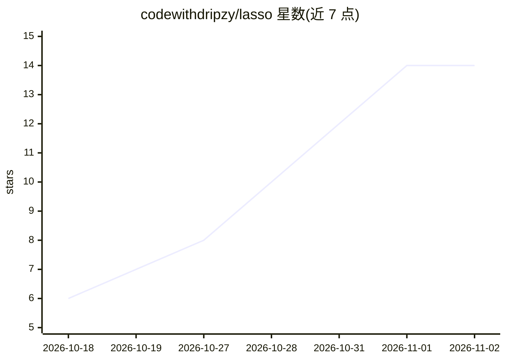

# codewithdripzy/lasso

⭐ 14 · TypeScript · ISC · 推送 2026-10-29 · [GitHub](https://github.com/codewithdripzy/lasso) · [官网](https://lasso.byorello.space) · 个人维护

**面向前端开发者的可视化 AI 编码工具：选中页面元素，让 agent 改真实源码**

Lasso 是一个 Node.js CLI 工具：在运行中的 Web 应用上选中某个元素，用自然语言描述改动，由用户选择的编码 agent（Claude Code、Codex、Cursor Agent、OpenCode、Antigravity 或 Lasso 托管模型）直接编辑真实源文件而非 DOM；改动出现在审阅托盘中，接受保留、拒绝回滚。支持启动 Vite、Next.js、Nuxt 项目，无需配置变更。附带 Lasso Host 提供稳定 .lasso 地址与开发服务器托管，需 Lasso 账户登录。通过 npm 全局安装或 npx 运行。

## 筛选速览

| 维度 | 判定 | 备注 |
|---|---|---|
| AI 角色 | `ai-ecosystem` | LLM/agent 周边工具 |
| 许可风险 | `permissive` | ISC |
| 部署形态 | `library` | 以包/库形式分发 |
| 模型依赖 | — | README 未给出锁定关系 |
| 硬件要求 | — | 无带数字的原话,不猜 |
| 安装摩擦 | `low` | 无编译、无系统依赖或容器化 |
| 成熟度 | — | 结构信号不足 |

## 能力要点

- 选中运行中应用的元素，描述改动，agent 直接编辑源文件（非 DOM）
- 可接入本机已安装的编码 CLI（Claude Code/Codex/Cursor Agent/OpenCode/Antigravity）或托管模型
- 审阅托盘：Accept 保留编辑，Reject 恢复文件至任务前状态
- 可启动 Vite/Next.js/Nuxt 项目，发现项目 SKILL.md 技能文件

## 适用场景

- 在运行中的前端页面上指着元素让 AI 修改对应源码
- 用已有的编码 agent CLI 处理选中元素相关的 UI 改动
- 通过审阅托盘逐个接受或回滚 AI 生成的文件编辑

## 场景标签

`编码 Agent` · 领域:编码与开发

## 证据(README 行号)

> L7: Select an element in your running app, describe the change, and review the files as your coding agent works.
> L58: Choose a hosted model in Lasso, or use a coding CLI already installed on your computer:
> L62: |Claude Code|`claude`|

## 星数曲线

2026-10-18 6 → 2026-11-02 14（+8）

---
*卡片 v1 · prompt 1.4 · 生成 2026-10-31 · 置信度 high · 依据 README sha `d1acdb4e4b6c` · [字段定义](../../DATASET.md)*
