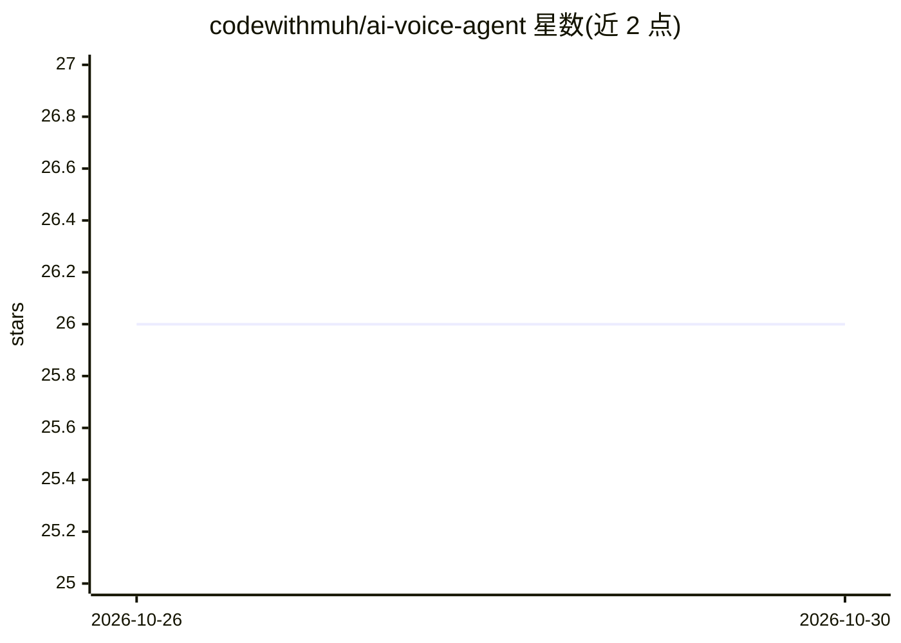

# codewithmuh/ai-voice-agent

⭐ 26 · Python · MIT · 推送 2026-10-26 · [GitHub](https://github.com/codewithmuh/ai-voice-agent) · [官网](https://codewithmuh.com/agents/voice-receptionist) · 个人维护

**AI 电话接待员：自动接听来电并预约日程**

基于 Django 的 AI 语音接待系统：通过 Vapi 承载电话与语音（STT/TTS），Django 后端调用 Claude API 进行对话理解与工具执行，实现 24/7 接听来电、查询 Google Calendar 实时空闲、自动创建日程事件，并通过 Twilio SMS 发送确认。通话转录、时长与摘要存入 PostgreSQL，提供 Django Admin 管理后台。需自行配置 Anthropic/Vapi/Twilio/Google 服务账号等 API key，用 Docker Compose 本地启动，经 ngrok 暴露后接入 Vapi。

## 筛选速览

| 维度 | 判定 | 备注 |
|---|---|---|
| AI 角色 | `ai-native` | 本体是模型或模型工具 |
| 许可风险 | `permissive` | MIT |
| 部署形态 | `self-host` | docker 或自建部署 |
| 模型依赖 | locked-api |  |
| 硬件要求 | — | 无带数字的原话,不猜 |
| 安装摩擦 | `low` | 无编译、无系统依赖或容器化 |
| 成熟度 | — | 结构信号不足 |

## 能力要点

- Vapi 语音传输层 + Claude function calling 的自主预约流程
- Google Calendar 服务账号实时查闲与建事件
- Twilio SMS 自动发送预约确认与提醒
- 通话转录/摘要/情感数据持久化到 PostgreSQL 并提供 Admin 后台

## 适用场景

- 诊所或服务型企业用 AI 接听电话并自动登记预约
- 减少前台漏接电话，24/7 处理预约请求
- 在 Django Admin 中查看通话记录与预约并手动调整

## 场景标签

`语音 Agent` · 领域:对话与助手

## 证据(README 行号)

> L30: Vapi is leveraged as the voice transport layer (Speech-to-Text and Text-to-Speech), while the Django backend acts a
> L44: |**LLM & Reasoning**|Claude API (Anthropic)|Context understanding, conversation flow, agentic tool execution|

## 星数曲线

2026-10-26 26 → 2026-10-30 26（+0）

---
*卡片 v1 · prompt 1.4 · 生成 2026-10-27 · 置信度 high · 依据 README sha `d809abc3a2a4` · [字段定义](../../DATASET.md)*
