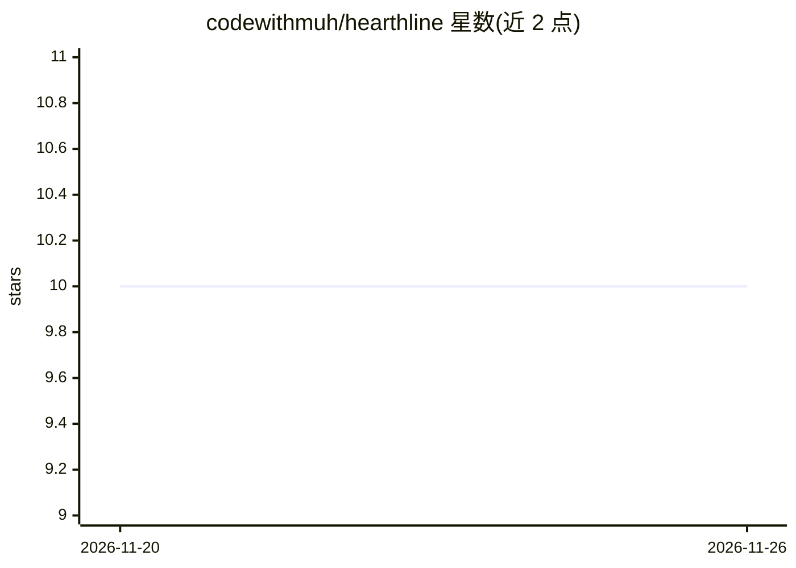

# codewithmuh/hearthline

⭐ 10 · TypeScript · AGPL-3.0 · 推送 2026-10-26 · [GitHub](https://github.com/codewithmuh/hearthline) · [官网](https://hearthline.codewithmuh.com) · 个人维护

**家政服务团队的 AI 前台：自动接听、报价、派单**

面向 HVAC、水管、屋顶、太阳能等 9 类家庭服务商户的自托管 AI 通讯中枢：入站电话、短信、WhatsApp、邮件、网页聊天汇入同一线程，由可配置姓名/人设/语音/知识库的品牌语音接待员自动接听、资格确认、报价并派给技师。技术栈为 Next.js 15 + Django 5 + Postgres 16，语音经 Vapi（Custom-LLM 模式）+ Twilio，LLM 编排用 Claude Sonnet 4.6，视觉用 GPT-4o；每商户自带 Anthropic/OpenAI/Vapi/Twilio API 密钥（Fernet 加密存储）。AGPL-3.0 许可，另有商业许可；无密钥时外部集成回退为 stub。

## 筛选速览

| 维度 | 判定 | 备注 |
|---|---|---|
| AI 角色 | `ai-native` | 本体是模型或模型工具 |
| 许可风险 | `dual` | AGPL-3.0 |
| 部署形态 | `self-host` | docker 或自建部署 |
| 模型依赖 | locked-api |  |
| 硬件要求 | — | 无带数字的原话,不猜 |
| 安装摩擦 | `low` | 无编译、无系统依赖或容器化 |
| 成熟度 | — | 结构信号不足 |

## 能力要点

- 品牌化语音接待员：每商户可配置人设、语音与知识库，24/7 接听
- 自带 API 密钥（BYOK）：Anthropic/OpenAI/Vapi/Twilio 每商户独立配置、加密存储
- 多渠道收件箱：电话+短信+WhatsApp+邮件+网页聊天同一时间线
- 10 种界面语言，含阿拉伯语 RTL

## 适用场景

- 给家政/维修公司自动接听入站电话并生成报价
- 将多渠道客户咨询汇总到统一工台并自动开单
- 自托管部署、用自己的 API 密钥替代订阅制 AI 前台 SaaS

## 场景标签

`语音 Agent` `聊天机器人` `工作流自动化` · 领域:效率与自动化

## 证据(README 行号)

> L3: > **The open-source AI front desk for home-service teams.**
> L37: Hearthline is the AI communication hub for HVAC, plumbing, windows, roofing,
> L123: |AI|Anthropic Claude Sonnet 4.6 (orchestration) + OpenAI GPT-4o (vision)|

## 星数曲线

2026-11-20 10 → 2026-11-26 10（+0）

---
*卡片 v1 · prompt 1.4 · 生成 2026-11-20 · 置信度 high · 依据 README sha `5fa1dd4a2ba8` · [字段定义](../../DATASET.md)*
