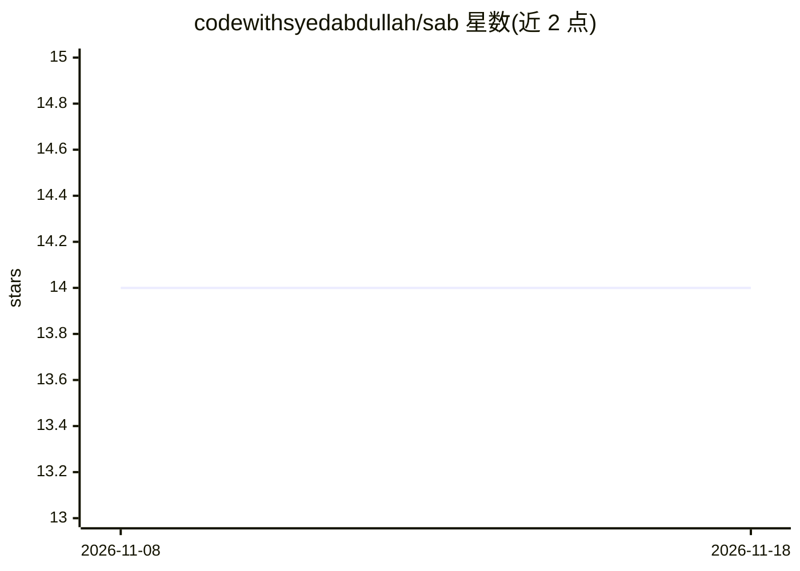

# codewithsyedabdullah/sab

⭐ 14 · JavaScript · MIT · 推送 2026-09-12 · [GitHub](https://github.com/codewithsyedabdullah/sab) · [官网](https://github.com/codewithsyedabdullah/sab) · 个人维护

**开源本地优先的 AI 编程助手：CLI+桌面端，支持本地与云端模型**

面向开发者的隐私优先编程 Agent，以 CLI 与 Electron 桌面应用两种形式提供，代码与对话均在本机处理。模型接入双通道：通过 Ollama 运行免费本地模型（如 codellama、qwen2.5-coder），或接入 Claude/GPT-4 及任意 OpenAI 兼容 API（DeepSeek、Gemini、Groq、OpenRouter 等，基于 LiteLLM）。Agent 具备读写编辑文件、执行 shell 命令、代码搜索等工具，含 faster-whisper 离线语音输入与会话记忆。桌面安装包捆绑 Python 运行时与 STT 引擎，安装后无需联网。

## 筛选速览

| 维度 | 判定 | 备注 |
|---|---|---|
| AI 角色 | `ai-native` | 本体是模型或模型工具 |
| 许可风险 | `permissive` | MIT |
| 部署形态 | `desktop` | 安装包/桌面程序 |
| 模型依赖 | local-ok | 支持本地模型 |
| 硬件要求 | — | 无带数字的原话,不猜 |
| 安装摩擦 | `low` | 无编译、无系统依赖或容器化 |
| 成熟度 | — | 结构信号不足 |

## 能力要点

- CLI + Electron 桌面应用双形态，本地运行、代码不出机器
- Ollama 本地模型与任意 OpenAI 兼容云端 API 双通道接入
- Agent 工具集：读写/编辑文件、执行命令、grep/glob 代码搜索
- faster-whisper 离线语音输入，桌面端内嵌 Python 运行时

## 适用场景

- 在终端或桌面端用本地模型离线进行 AI 辅助编程
- 切换使用 Claude/GPT-4 或 DeepSeek/Groq 等云端模型写代码
- 在注重代码隐私的环境下让 AI 代为执行文件操作与命令

## 场景标签

`编码 Agent` `语音识别` · 领域:编码与开发

## 证据(README 行号)

> L19: SAB is an **open-source, privacy-first coding agent** that lives on your machine. Talk to it from the **terminal** 
> L21: Connect it to **free local models** through Ollama, or plug in **cloud APIs** like Claude and GPT-4. Full voice inp
> L29: - **Cloud LLM** — Claude, GPT-4, any OpenAI-compatible API

## 星数曲线

2026-11-08 14 → 2026-11-18 14（+0）

---
*卡片 v1 · prompt 1.4 · 生成 2026-11-18 · 置信度 mid · 依据 README sha `884b412ae476` · [字段定义](../../DATASET.md)*
