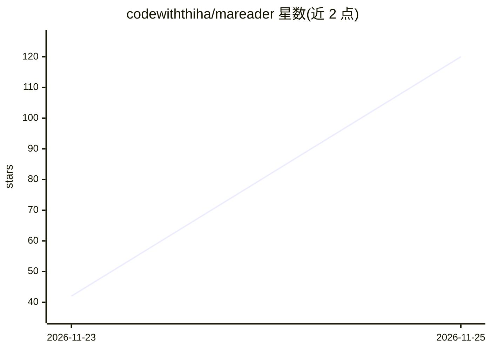

# codewiththiha/mareader

⭐ 120 · Rust · MIT · 推送 2026-11-23 · [GitHub](https://github.com/codewiththiha/mareader) · 个人维护

**跨平台 PDF/EPUB 阅读器：四窗对照、批注、离线朗读与 AI 辅助**

基于 Rust/egui 构建的桌面阅读器，支持 PDF 与 EPUB 的阅读、搜索与翻页浏览；最多四窗并排对照，可做高亮与笔记管理。朗读功能使用本地语音模型（Kokoro、Piper、Kitten、Phonon），离线可用。AI 部分提供词义解释、摘要、翻译、简化与词汇 CEFR 分级着色，模型可在托管服务与 OpenAI 兼容本地服务间按任务选择。提供三大平台预编译包，也可从源码构建。

## 筛选速览

| 维度 | 判定 | 备注 |
|---|---|---|
| AI 角色 | `ai-enhanced` | 去掉 AI 部分产品仍成立 |
| 许可风险 | `permissive` | MIT |
| 部署形态 | `None` |  |
| 模型依赖 | — | README 未给出锁定关系 |
| 硬件要求 | — | 无带数字的原话,不猜 |
| 安装摩擦 | `low` | 无编译、无系统依赖或容器化 |
| 成熟度 | — | 结构信号不足 |

## 能力要点

- 四窗并排阅读，支持竖排中文 EPUB
- 本地语音模型离线朗读（Kokoro/Piper/Kitten/Phonon）
- CEFR 词汇分级着色与语境词典/AI 查询
- 按任务配置托管或 OpenAI 兼容本地模型

## 适用场景

- 在同一界面并排对照多本书与参考文献
- 学外语时按 CEFR 等级标记生词并查询
- 离线将电子书朗读出来听
- 阅读时让 AI 解释词义、总结或翻译段落

## 场景标签

`语音合成` `文档问答` · 领域:内容生成

## 证据(README 行号)

> L5:  A reader for PDFs and EPUBs, shaped around the way you read.
> L22: |AI reading tools|Explain words in context, summarize, translate, simplify, and organize a library.|AI guide|
> L24: |AI model setup|Choose providers and models by task, including hosted and OpenAI-compatible local services.|Model s

## 星数曲线

2026-11-23 42 → 2026-11-25 120（+78）

---
*卡片 v1 · prompt 1.4 · 生成 2026-11-23 · 置信度 high · 依据 README sha `cdc4248c0339` · [字段定义](../../DATASET.md)*
