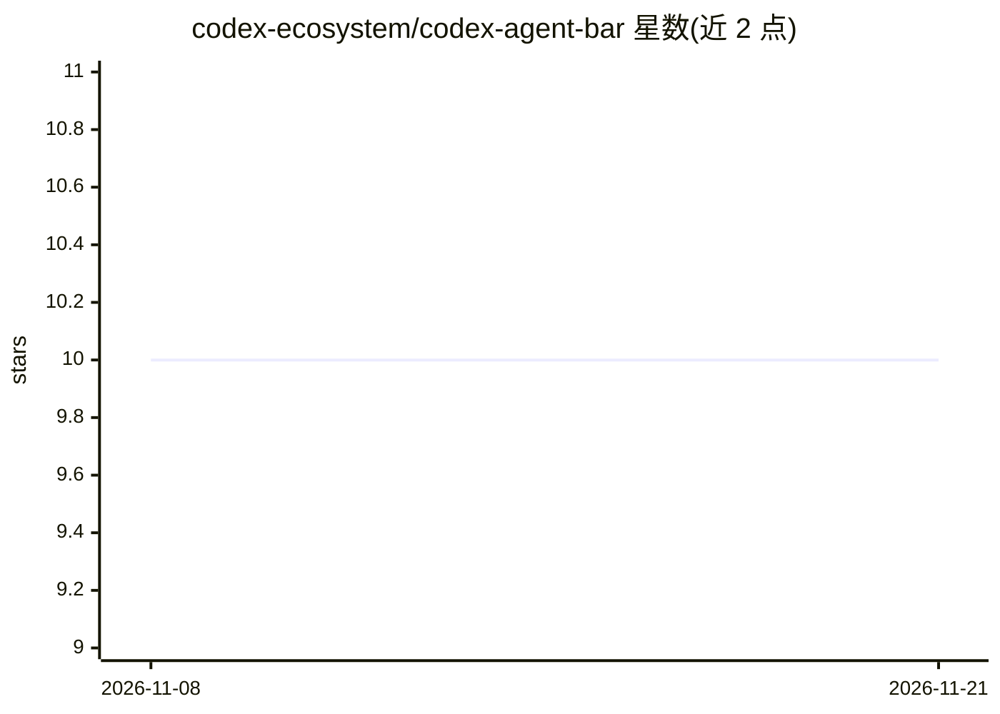

# codex-ecosystem/codex-agent-bar

⭐ 10 · Swift · MIT · 推送 2026-10-27 · [GitHub](https://github.com/codex-ecosystem/codex-agent-bar) · 个人维护

**macOS 菜单栏应用：实时显示 Codex 配额余量**

一个轻量级 macOS 菜单栏应用，通过连接本地 codex app-server 读取账号速率限制数据，将剩余配额直接显示在系统菜单栏。功能包括短期与长期配额窗口（5 小时/1 周）、颜色状态提示、配额进度弹窗与重置时间展示，每 30 秒自动刷新，以菜单栏附属应用形式运行（不进入 Dock）。要求本机已安装并登录 Codex，支持 Apple Silicon 与 macOS 13+，通过 Homebrew Cask 安装。

## 筛选速览

| 维度 | 判定 | 备注 |
|---|---|---|
| AI 角色 | `ai-ecosystem` | LLM/agent 周边工具 |
| 许可风险 | `permissive` | MIT |
| 部署形态 | `None` |  |
| 模型依赖 | — | README 未给出锁定关系 |
| 硬件要求 | — | 无带数字的原话,不猜 |
| 安装摩擦 | `low` | 无编译、无系统依赖或容器化 |
| 成熟度 | — | 结构信号不足 |

## 能力要点

- 菜单栏直接显示 Codex 配额余量与 5 小时/1 周窗口
- 每 30 秒自动刷新，颜色编码提示低余量
- 通过 which codex 定位 CLI 并复用登录 shell 的 PATH
- 启动及每小时自动检查更新，可用手动检查

## 适用场景

- 随时查看 Codex 账号配额还剩多少
- 在配额即将耗尽前收到颜色提示
- 查看配额重置时间安排使用节奏

## 场景标签

 · 领域:开发者工具/监控

## 证据(README 行号)

> L7: Codex Agent Bar is a lightweight macOS menu bar app for monitoring your Codex quota at a glance. It connects to the 
> L18: Agent Bar needs an available, signed-in Codex installation.

## 星数曲线

2026-11-08 10 → 2026-11-21 10（+0）

---
*卡片 v1 · prompt 1.4 · 生成 2026-11-19 · 置信度 high · 依据 README sha `b686b6f7b1ac` · [字段定义](../../DATASET.md)*
