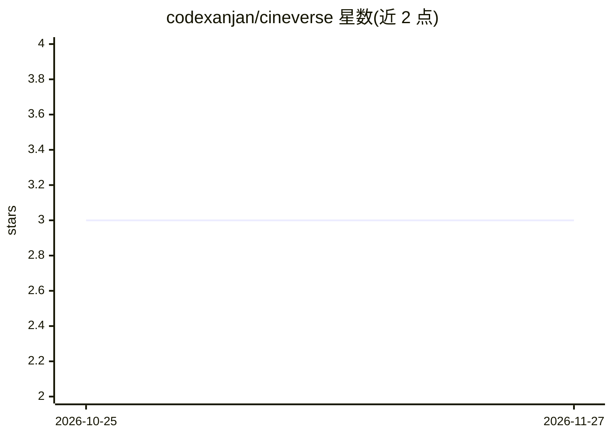

# codexanjan/cineverse

⭐ 3 · TypeScript · MIT · 推送 2026-10-15 · [GitHub](https://github.com/codexanjan/cineverse) · [官网](https://cineverseai.vercel.app) · 个人维护

**给影迷的电影推荐引擎：自然语言与心情偏好的混合推荐**

由 Next.js 前端与 FastAPI 后端组成电影发现与推荐应用：自然语言主题搜索经 TF-IDF+TruncatedSVD 编码进 100 维语义空间，结合 MovieLens 矩阵分解的协同过滤做多目标混合排序；支持 6 轴心情滑杆、19 类型口味 DNA、2-8 人群 minimax 共识求解与冷门佳片扫描。结果附 TMDB 海报与 YouTube 预告片。本地运行需 Node.js 22+ 与 Python 3.12+，亦可 Docker Compose 启动含 PostgreSQL(pgvector)/Redis 的全栈。

## 筛选速览

| 维度 | 判定 | 备注 |
|---|---|---|
| AI 角色 | `ai-native` | 本体是模型或模型工具 |
| 许可风险 | `permissive` | MIT |
| 部署形态 | `self-host` | docker 或自建部署 |
| 模型依赖 | — | README 未给出锁定关系 |
| 硬件要求 | — | 无带数字的原话,不猜 |
| 安装摩擦 | `low` | 无编译、无系统依赖或容器化 |
| 成熟度 | — | 结构信号不足 |

## 能力要点

- TF-IDF+TruncatedSVD 语义编码的自然语言电影搜索
- MovieLens 矩阵分解协同过滤与多因子混合排序
- 2-8 人群体 minimax 公平共识求解
- 每条推荐附透明理由与口味雷达可视化

## 适用场景

- 用抽象情绪描述找片（如'雨夜温暖悬疑'）
- 多人观影夜协商看什么
- 发现高评分低曝光的独立与世界电影

## 场景标签

`推荐系统` `语义搜索` · 领域:知识与检索

## 证据(README 行号)

> L59: 1. **Intent Capture**: The viewer enters a natural-language description (e.g., *"existential deep-space psychologic
> L129: Cineverse combines collaborative filtering, latent semantic indexing, and content-based heuristics into an ensembl

## 星数曲线

2026-10-25 3 → 2026-11-27 3（+0）

---
*卡片 v1 · prompt 1.4 · 生成 2026-11-22 · 置信度 high · 依据 README sha `5c1bab270844` · [字段定义](../../DATASET.md)*
