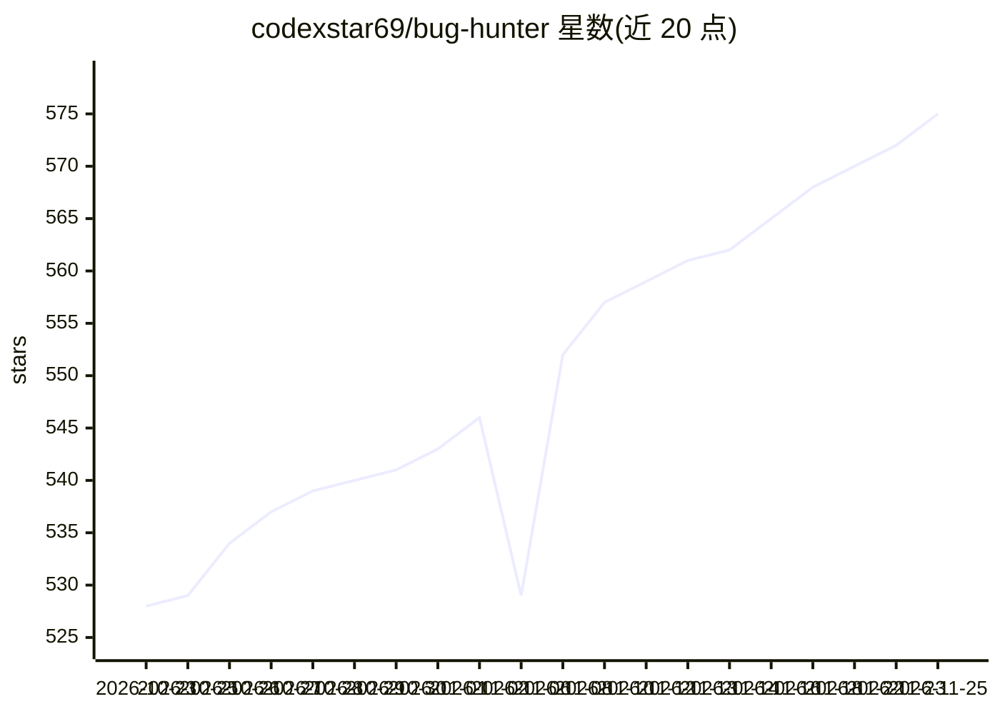

# codexstar69/bug-hunter

⭐ 575 · JavaScript · MIT · 推送 2026-10-29 · [GitHub](https://github.com/codexstar69/bug-hunter) · 个人维护

**给 AI 编码代理安装的对抗式代码审计技能**

以 AI 代理技能（skill）形式分发的代码审计工具：流水线包含风险分诊、Hunter 找出候选缺陷、Skeptic 反驳每条主张、Referee 裁决证据，输出 REAL_BUG/NOT_A_BUG/MANUAL_REVIEW 判定与 canonical JSON 工件。默认仅扫描报告且单轮，编辑、修复与提交均需显式授权；修复仅在安全分支/授权范围内执行。通过 npx/npm 安装到 Claude Code、Cursor、Codex CLI 等代理的技能目录，用自然语言或 /bug-hunter 命令触发扫描，需 Node.js 22+。

## 筛选速览

| 维度 | 判定 | 备注 |
|---|---|---|
| AI 角色 | `ai-native` | 本体是模型或模型工具 |
| 许可风险 | `permissive` | MIT |
| 部署形态 | `library` | 以包/库形式分发 |
| 模型依赖 | — | README 未给出锁定关系 |
| 硬件要求 | — | 无带数字的原话,不猜 |
| 安装摩擦 | `low` | 无编译、无系统依赖或容器化 |
| 成熟度 | — | 结构信号不足 |

## 能力要点

- Hunter/Skeptic/Referee 对抗式三角色验证，区分确认、驳回与需人工复核的结果
- 默认 scan-only 单轮运行，编辑/自主修复/提交需逐级显式授权，验证失败即 fail-closed
- 带基准质量门：precision/recall/F1、校准与重复稳定性等指标评分
- 捆绑 PR 安全审查、全仓安全审查、STRIDE 威胁建模、漏洞验证等技能

## 适用场景

- 让 Claude Code 或 Cursor 扫描仓库，找出逻辑错误与安全漏洞
- 对 PR 或暂存变更做安全审查与依赖 CVE 扫描
- 生成修复计划并在授权后由代理自动修复缺陷

## 场景标签

`多智能体` `代码审查` · 领域:Agent 开发

## 证据(README 行号)

> L21: Bug Hunter is an AI-agent skill for code review and security auditing. A Hunter finds possible bugs, a Skeptic chal
> L233: |Hunter|Finds reachable logic, security, concurrency, data, and error-path bugs|`hunter-findings.json`|
> L236: |Referee|Delivers `REAL_BUG`, `NOT_A_BUG`, or `MANUAL_REVIEW` verdicts|`referee.json`|

## 星数曲线

2026-10-23 528 → 2026-11-25 575（+47）

---
*卡片 v1 · prompt 1.4 · 生成 2026-11-25 · 置信度 high · 依据 README sha `0f7307d789b5` · [字段定义](../../DATASET.md)*
