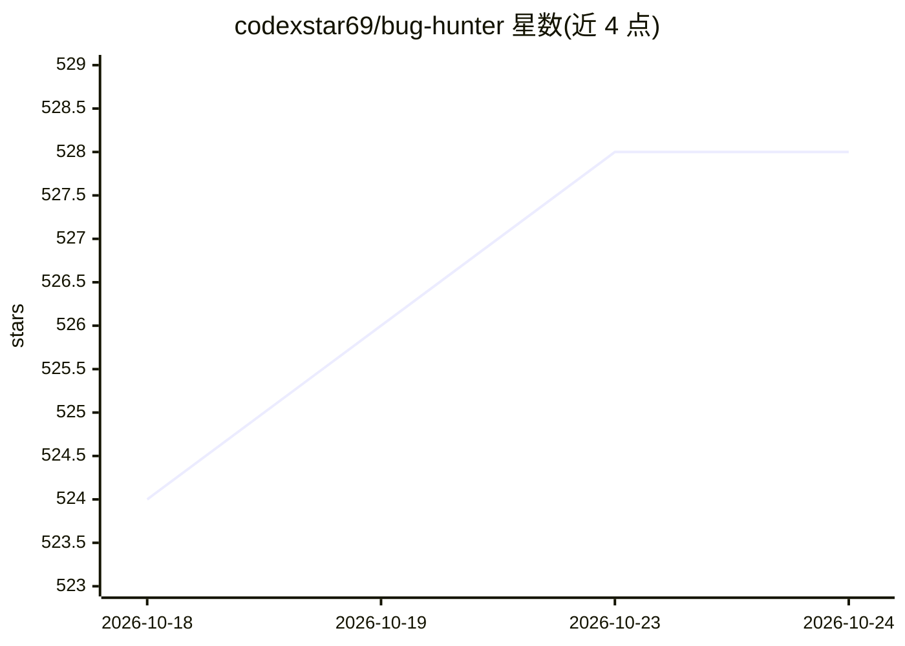

# codexstar69/bug-hunter

⭐ 529 · JavaScript · MIT · 推送 2026-08-17 · [GitHub](https://github.com/codexstar69/bug-hunter) · 个人维护

**面向 AI 编码 agent 的对抗式代码审计技能，扫描并可授权修复缺陷**

以 npm 包分发的 AI-agent 技能（skill），安装到 Claude Code、Codex、Cursor、Copilot 等 8 种编码 agent 中运行。核心是三角色对抗流水线：Hunter 提出缺陷声明、Skeptic 反证、Referee 出具 REAL_BUG/NOT_A_BUG/MANUAL_REVIEW 裁决，前后含确定性风险分诊、检索规划、混合验证（测试/类型/静态/模糊检查）与可选修复规划。默认只扫描单轮不编辑，编辑、修复与提交均需显式授权；各阶段以 schema 校验的 JSON 制品为事实源，验证缺失即 fail-closed。附带 PR 安全审查、STRIDE 威胁建模等安全子技能。要求 Node.js 22+。

## 筛选速览

| 维度 | 判定 | 备注 |
|---|---|---|
| AI 角色 | `ai-ecosystem` | LLM/agent 周边工具 |
| 许可风险 | `permissive` | MIT |
| 部署形态 | `library` | 以包/库形式分发 |
| 模型依赖 | — | README 未给出锁定关系 |
| 硬件要求 | — | 无带数字的原话,不猜 |
| 安装摩擦 | `low` | 无编译、无系统依赖或容器化 |
| 成熟度 | — | 结构信号不足 |

## 能力要点

- Hunter/Skeptic/Referee 三角色对抗裁决，输出 REAL_BUG/NOT_A_BUG/MANUAL_REVIEW
- 默认 scan-only 单轮模式，编辑/修复/提交均需显式授权，验证失败即 fail-closed
- 支持 8 种编码 agent（Claude Code、Codex、Cursor、Copilot、Kiro、Windsurf、OpenCode、Factory Droid）
- 附带 PR 安全审查、STRIDE 威胁建模、漏洞验证等安全子技能

## 适用场景

- 让我的编码 agent 扫描仓库找出真实缺陷并区分误报
- 对 PR 或暂存变更做安全审查
- 在授权后让 agent 在分支上生成修复计划并自动修复
- 为代码库生成 STRIDE 威胁模型

## 场景标签

`多智能体` `代码审查` `网络安全` · 领域:Agent 开发

## 证据(README 行号)

> L21: Bug Hunter is an AI-agent skill for code review and security auditing. A Hunter finds possible bugs, a Skeptic chal
> L44: ```bash
> L69: |Claude Code|`claude-code`|

## 星数曲线



2026-10-18 524 → 2026-10-24 528（+4）


---
*卡片 v1 · prompt 1.4 · 生成 2026-10-22 · 置信度 high · 依据 README sha `2fc9cb0d7849` · [字段定义](../../DATASET.md)*
