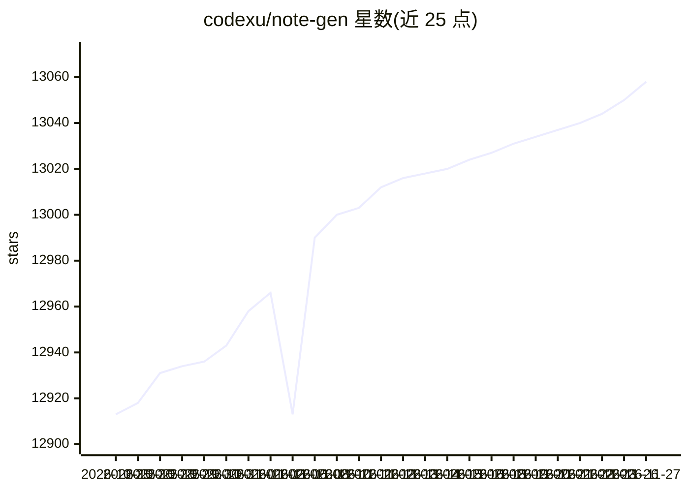

# codexu/note-gen

⭐ 13,058 · TypeScript · GPL-3.0 · 推送 2026-11-26 · [GitHub](https://github.com/codexu/note-gen) · [官网](https://notegen.top) · 个人维护 · 中文 README

**本地优先的 Markdown 笔记应用：先速记碎片，再用 AI 整理成笔记**

跨桌面与移动端的本地优先 Markdown 应用，主张「先捕获、后整理」：随手保存文字、语音、截图、链接、文件等碎片记录，之后按标签/时间/类型筛选素材，交给 AI 按模板或描述整理为总结、报告、文章等 Markdown 结构，再在编辑器中人工继续写作。笔记以普通 Markdown 文件存储在工作区，可配合 Git 使用；支持 LLM Wiki 主题汇总、RAG 向量检索、Agent 模式、MCP 服务器与可安装 Skills；同步支持官方服务、自托管服务及 GitHub/WebDAV/S3 等多种途径。

## 筛选速览

| 维度 | 判定 | 备注 |
|---|---|---|
| AI 角色 | `ai-native` | 本体是模型或模型工具 |
| 许可风险 | `viral` | GPL-3.0 |
| 部署形态 | `None` |  |
| 模型依赖 | — | README 未给出锁定关系 |
| 硬件要求 | — | 无带数字的原话,不猜 |
| 安装摩擦 | `low` | 无编译、无系统依赖或容器化 |
| 成熟度 | `idea` | |

## 能力要点

- 碎片捕获→选材→AI 整理→人工续写的工作流
- 笔记保持为普通 Markdown 文件，无专有格式锁定
- LLM Wiki 与 RAG：嵌入模型向量检索+关键词/模糊搜索，可选 reranker
- 多平台安装包（Windows/macOS/Linux/Android/iOS），同步可自托管

## 适用场景

- 会议中随手记片段和截图，会后一键整理成会议纪要
- 平时囤积链接和阅读片段，周末整理为研究笔记
- 按标签筛选近期记录生成周报
- 基于本地笔记和知识库内容向 AI 提问

## 场景标签

`知识库管理` `RAG` `AI 写作` · 领域:内容生成

## 证据(README 行号)

> L5: A local-first Markdown app that helps you collect scattered information and organize it into clear notes with AI.
> L101: NoteGen connects to the AI providers and models you configure. You can use different models for chat, writing, emb
> L105: - Organize selected records into a structured note

## 星数曲线

2026-10-25 12,913 → 2026-11-27 13,058（+145）

---
*卡片 v1 · prompt 1.4 · 生成 2026-11-22 · 置信度 mid · 依据 README sha `8d718b6e6906` · [字段定义](../../DATASET.md)*
