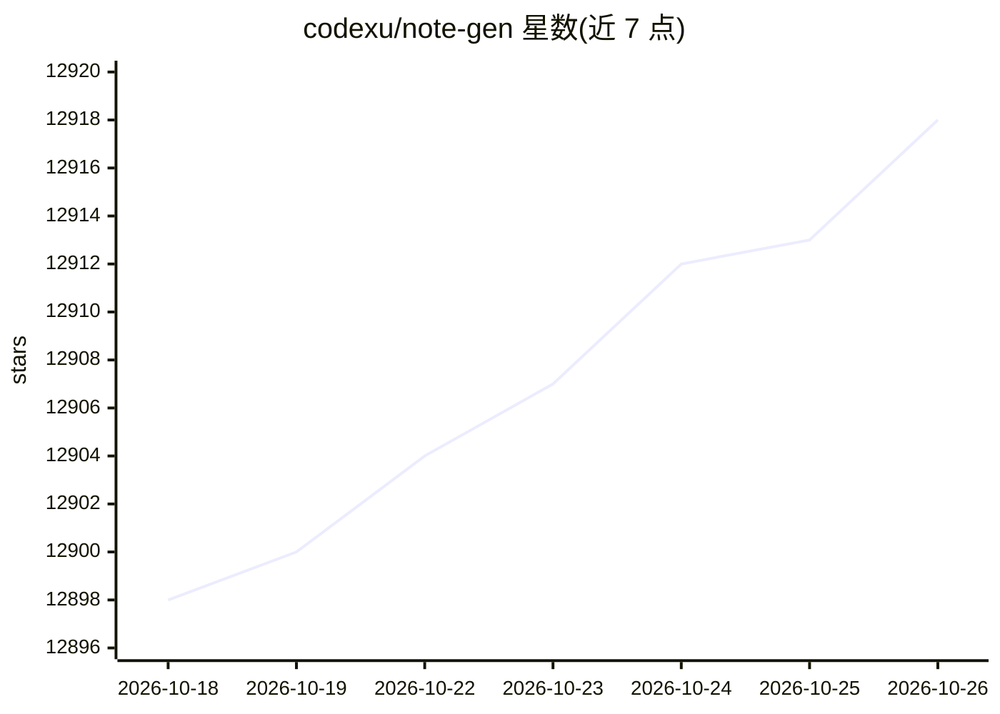

# codexu/note-gen

⭐ 12,918 · TypeScript · GPL-3.0 · 推送 2026-10-25 · [GitHub](https://github.com/codexu/note-gen) · [官网](https://notegen.top) · 个人维护 · 中文 README

**本地优先的 Markdown 记录与笔记应用，AI 辅助整理碎片信息**

跨平台（桌面/移动）的本地优先 Markdown 笔记应用：先以文字、语音、截图、链接、文件等形式快速记录，之后按标签/时间/类型筛选记录，由用户配置的 AI 模型将素材整理为结构化 Markdown 笔记。笔记以普通 Markdown 文件存储在用户指定工作区，支持多种 Git 与云存储同步。AI 功能涵盖整理、改写、翻译、问答、向量检索知识库、MCP、Agent 模式等，需用户自行配置 AI 提供商方可使用。GPL-3.0 许可。

## 筛选速览

| 维度 | 判定 | 备注 |
|---|---|---|
| AI 角色 | `ai-enhanced` | 去掉 AI 部分产品仍成立 |
| 许可风险 | `viral` | GPL-3.0 |
| 部署形态 | `None` |  |
| 模型依赖 | — | README 未给出锁定关系 |
| 硬件要求 | — | 无带数字的原话,不猜 |
| 安装摩擦 | `low` | 无编译、无系统依赖或容器化 |
| 成熟度 | `idea` | |

## 能力要点

- 记录与整理分离：先捕获碎片素材，后由 AI 整理成结构化笔记
- 笔记为普通 Markdown 文件，可用其他编辑器打开、Git 管理，多途径同步
- 支持向量索引与混合检索的知识库、MCP 服务器、可安装 Skills 与 Agent 工具
- 提供画布工作区（流程图/思维导图/时间轴/图表）与插件 SDK

## 适用场景

- 会议录音加截图事后整理成会议纪要
- 一周内收藏的链接和摘录整理为研究笔记
- 把笔记和记录作为上下文向 AI 提问或生成周报
- 本地 Markdown 文件管理并在多设备间同步

## 场景标签

`知识库管理` · 领域:知识与检索

## 证据(README 行号)

> L5: A local-first Markdown app that helps you collect scattered information and organize it into clear notes with AI.
> L97: NoteGen connects to the AI providers and models you configure. You can use different models for chat, writing, embe
> L174: 4. Configure an AI provider when you want to use AI features.

## 星数曲线

2026-10-18 12,898 → 2026-10-26 12,918（+20）

---
*卡片 v1 · prompt 1.4 · 生成 2026-10-20 · 置信度 high · 依据 README sha `018500abaa28` · [字段定义](../../DATASET.md)*
