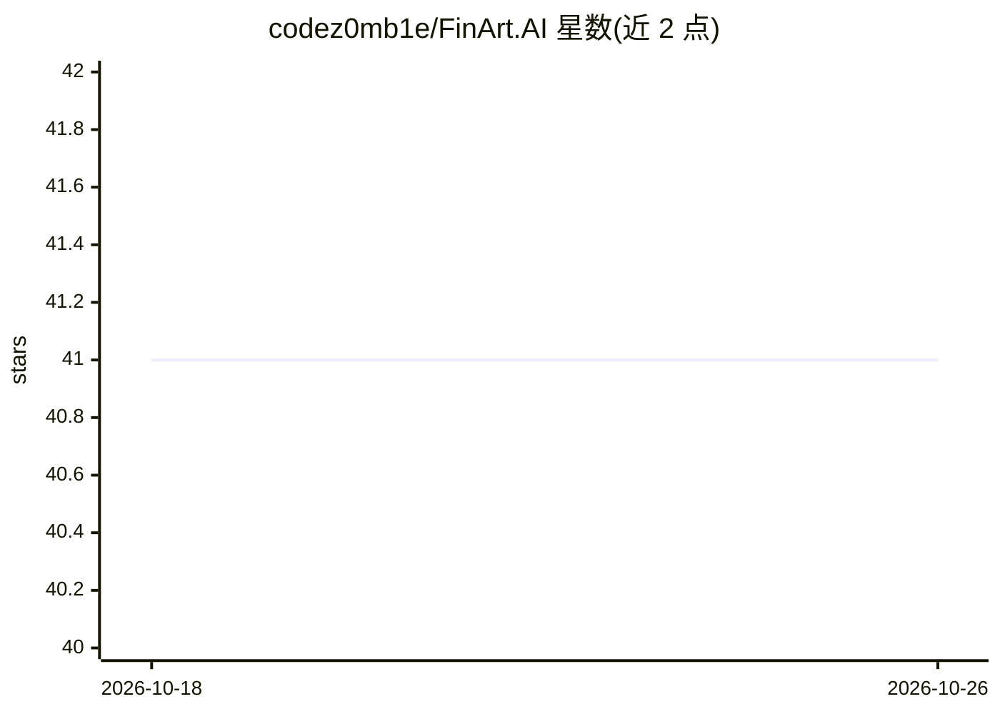

# codez0mb1e/FinArt.AI

⭐ 41 · MIT · 推送 2026-03-07 · [GitHub](https://github.com/codez0mb1e/FinArt.AI) · 个人维护

**AI 在金融领域的资源清单：数据集、论文、案例与框架**

策展式 awesome 清单，汇集金融领域 AI 应用的数据集、研究论文、用例、库与框架等资源。主体为 ML for Financial Markets 板块，覆盖量化分析与交易，按数据集、服务与 API、研究论文、框架、课程分类；另以表格列出零售银行、保险等其他金融板块的资源覆盖情况，并单列算法/模型/论文枢纽与数据枢纽、数据隐私栏目。给金融 AI 从业者与研究者做资源检索使用。

## 筛选速览

| 维度 | 判定 | 备注 |
|---|---|---|
| AI 角色 | `ai-knowledge` | 知识聚合/清单类 |
| 许可风险 | `permissive` | MIT |
| 部署形态 | `None` |  |
| 模型依赖 | — | README 未给出锁定关系 |
| 硬件要求 | — | 无带数字的原话,不猜 |
| 安装摩擦 | `low` | 无编译、无系统依赖或容器化 |
| 成熟度 | — | 结构信号不足 |

## 能力要点

- 金融领域数据集、论文、用例、库与框架的策展清单
- ML for Financial Markets 板块面向量化分析与交易
- 按零售银行、保险等板块组织资源覆盖矩阵

## 适用场景

- 寻找金融领域可用的公开数据集与数据枢纽
- 查找量化交易方向的 ML 框架与研究论文
- 按金融子行业浏览 AI 用例资源

## 场景标签

`精选清单` `金融量化` · 领域:学习与行业

## 证据(README 行号)

> L5: A curated list of insanely awesome *financial data sets*, *research papers*, *use cases*, *libraries*, *frameworks* 
> L11: List for Quantitative analysis and Trading.

## 星数曲线

2026-10-18 41 → 2026-10-26 41（+0）

---
*卡片 v1 · prompt 1.4 · 生成 2026-10-25 · 置信度 high · 依据 README sha `3b726cc94079` · [字段定义](../../DATASET.md)*
