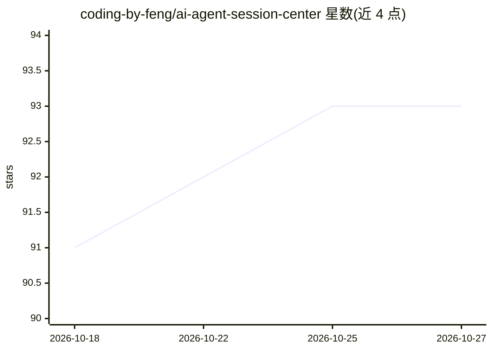

# coding-by-feng/ai-agent-session-center

⭐ 93 · TypeScript · MIT · 推送 2026-10-26 · [GitHub](https://github.com/coding-by-feng/ai-agent-session-center) · [官网](https://aasc.work) · 个人维护

**Claude Code/Codex 会话的实时监控面板**

面向使用 Claude Code 与 Codex CLI 的开发者的会话管理中心：通过 hook 脚本捕获 CLI 事件，经队列文件与服务器状态机推送到 WebSocket 仪表盘，实时显示各 agent 的工作/等待/待审批状态并支持声音告警。功能包括服务端持有的 xterm.js 共享实时终端、提示词队列（一次/循环/定时）、自动续跑、重启后工作区恢复、项目浏览器与对话记录检索、以及可选 3D 场景。提供 macOS arm64 桌面安装包（未公证）或源码运行（Node.js 22.12+），亦可浏览器访问，演示站 aasc.work/demo。限制：会话匹配为启发式、循环任务需保持窗口开启、Windows hook 测试较少。

## 筛选速览

| 维度 | 判定 | 备注 |
|---|---|---|
| AI 角色 | `ai-ecosystem` | LLM/agent 周边工具 |
| 许可风险 | `permissive` | MIT |
| 部署形态 | `desktop` | 安装包/桌面程序 |
| 模型依赖 | locked-api |  |
| 硬件要求 | — | 无带数字的原话,不猜 |
| 安装摩擦 | `low` | 无编译、无系统依赖或容器化 |
| 成熟度 | — | 结构信号不足 |

## 能力要点

- hook 事件→服务器状态机→WebSocket 的实时会话状态推送
- 服务端持有的 xterm.js 共享终端（浏览器/桌面/手机）
- 提示词队列与一次/循环/定时、静默时段
- 自动续跑（过载/5xx/限流时发送 continue）与重启后工作区恢复

## 适用场景

- 同时跑多个 Claude Code/Codex 会话时掌握哪个 agent 在等我
- 排队下一个提示词，会话空闲时自动发送
- 通过手机或局域网设备接管正在运行的 agent 终端

## 场景标签

`LLM 可观测性` · 领域:评测与运维

## 证据(README 行号)

> L3: **One dashboard for all your Claude Code and Codex sessions — see which agent needs you, work in live terminals, que
> L61: Claude Code / Codex → hook script (background, never blocks the CLI)
> L63:   → server (match event to session → state machine) → WebSocket → dashboard

## 星数曲线

2026-10-18 91 → 2026-10-27 93（+2）

---
*卡片 v1 · prompt 1.4 · 生成 2026-10-23 · 置信度 high · 依据 README sha `a1a9cf9ae712` · [字段定义](../../DATASET.md)*
