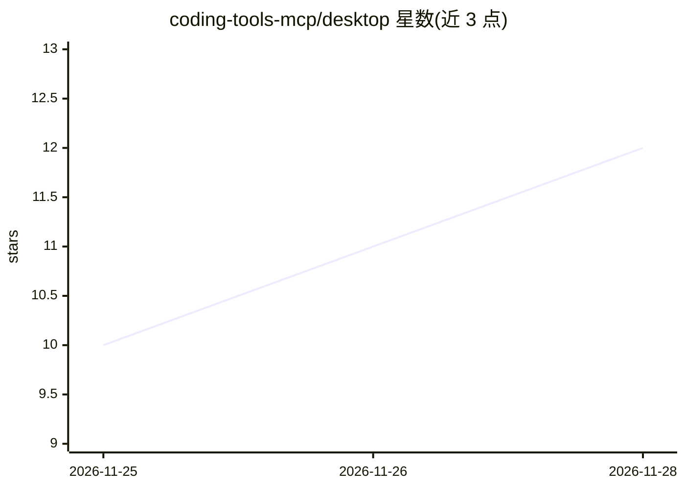

# coding-tools-mcp/desktop

⭐ 12 · Rust · Apache-2.0 · 推送 2026-11-20 · [GitHub](https://github.com/coding-tools-mcp/desktop) · 组织维护

**管理 Coding Tools MCP Python 进程的本地桌面应用**

基于 Rust + Tauri 2 与 React/TypeScript/Mantine 的桌面应用，用于运行和管理外部 Coding Tools MCP Python 进程。功能覆盖工作区管理、进程生命周期、工具调用历史展示、Cloudflare Tunnel/FRP 远程访问与多种认证（Bearer/URL token/Basic/OAuth）。原生安装包内置安装辅助，无需用户自装 Python 或 uv；也可指向已有 Core。safe 权限模式限制命令执行，非只读工作区；PyPI 0.5.0 版不提供事件日志功能。

## 筛选速览

| 维度 | 判定 | 备注 |
|---|---|---|
| AI 角色 | `ai-ecosystem` | LLM/agent 周边工具 |
| 许可风险 | `permissive` | Apache-2.0 |
| 部署形态 | `desktop` | 安装包/桌面程序 |
| 模型依赖 | — | README 未给出锁定关系 |
| 硬件要求 | — | 无带数字的原话,不猜 |
| 安装摩擦 | `low` | 无编译、无系统依赖或容器化 |
| 成熟度 | — | 结构信号不足 |

## 能力要点

- 原生安装包内置安装辅助，无需自装 Python 或 uv
- 支持 Local only、Cloudflare Quick/Named Tunnel 与 FRP 三类远程访问
- 四种公开访问认证方式，客户端配置一键复制
- 展示 Core 的真实结构化工具调用事件（工具名/时间戳/时长/结果）

## 适用场景

- 为本地编码 Agent 工作区启动并管理 MCP 服务器
- 通过 Cloudflare Tunnel 或 FRP 从外部访问本地 MCP
- 查看工具调用历史与诊断运行状态

## 场景标签

 · 领域:开发者工具/MCP 基础设施

## 证据(README 行号)

> L3: A local-first **Rust + Tauri 2** application with a **React, TypeScript and Mantine** interface. It manages an exter
> L8: 2. Choose **Install recommended Core** in Settings, or **Use existing Core** in the new workspace wizard. Native bun

## 星数曲线

2026-11-25 10 → 2026-11-28 12（+2）

---
*卡片 v1 · prompt 1.4 · 生成 2026-11-24 · 置信度 mid · 依据 README sha `2bbecd221b4d` · [字段定义](../../DATASET.md)*
