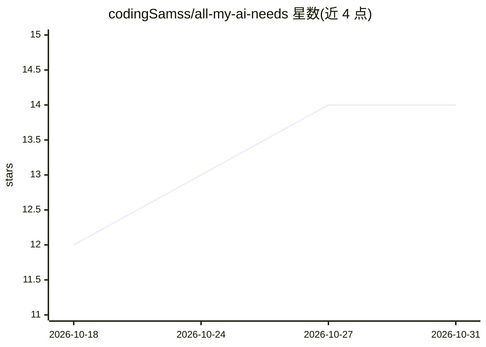

# codingSamss/all-my-ai-needs

⭐ 14 · Python · 推送 2026-10-17 · [GitHub](https://github.com/codingSamss/all-my-ai-needs) · 个人维护 · 中文 README

**管理 Claude Code 与 Codex 双平台 skills 的 dotfiles 真源仓库**

个人 AI 配置仓库：按 platform-first 结构分别维护 Claude Code 与 Codex 两端的 skills 真源与运行约定，同名 skill 允许两端并存。核心机制是 agent 写入、人审校——agent 拉取仓库后按 runtime.yaml 与 skills.meta.yaml 做最小差异同步到 ~/.claude 与 ~/.codex 运行目录，仓库本身不提供全局镜像脚本；治理元数据不入运行目录、私有配置不回流。另含一个点名安装的可选 Claude Code 桌面宠物 Mod（Python 安装器，离线组装、SHA-256 校验）。限制：同步依赖 agent 驱动而非脚本，Mod 处于 rc 版本且未做原生 App 新会话实测。

## 筛选速览

| 维度 | 判定 | 备注 |
|---|---|---|
| AI 角色 | `ai-ecosystem` | LLM/agent 周边工具 |
| 许可风险 | `none` | — |
| 部署形态 | `None` |  |
| 模型依赖 | — | README 未给出锁定关系 |
| 硬件要求 | — | 无带数字的原话,不猜 |
| 安装摩擦 | `low` | 无编译、无系统依赖或容器化 |
| 成熟度 | `idea` | |

## 能力要点

- platform-first 双平台 skills 真源，同名 skill 按平台独立演化
- agent 写入、人审校的同步模型（skills.meta.yaml + runtime.yaml）
- scope（core/project/manual-only）与 profile 分层控制 skill 下发
- 可选 pixel-buddy Mod 提供离线安装器（Python 3.9+，SHA-256 校验）

## 适用场景

- 我在多台机器间保持 Claude Code 与 Codex 的 skills 配置一致
- 我按项目类型选择下发哪些 skill 到运行目录
- 我让 agent 自动同步 skill 并人工审校差异

## 场景标签

 · 领域:开发者工具/AI 配置管理

## 证据(README 行号)

> L7: 仓库要解决的是多端 AI 配置的漂移——GitHub 仓库、本地工作区、本地 CLI 运行目录（`~/.claude`、`~/.codex`）三者保持一致。所有写入（同步、提交、推送）由 agent 执行：agent 拉仓库后读 `
> L21: 2. **agent 写入 · 人审校** —— 仓库内容默认由 agent 维护。涉及写入的操作先产出差异清单交人审批再执行；仓库不提供全局镜像脚本；skills 同步由 agent 读元数据完成，可选 Mod 使用自身经过审查

## 星数曲线

2026-10-18 12 → 2026-10-31 14（+2）

---
*卡片 v1 · prompt 1.4 · 生成 2026-10-31 · 置信度 high · 依据 README sha `aaaf7736c84b` · [字段定义](../../DATASET.md)*
