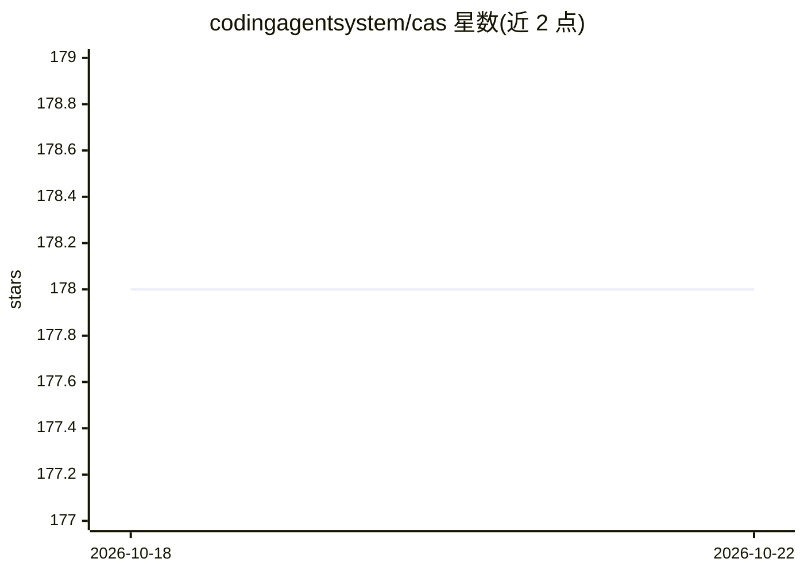

# codingagentsystem/cas

⭐ 178 · Rust · MIT · 推送 2026-03-12 · [GitHub](https://github.com/codingagentsystem/cas) · [官网](https://codingagentsystem.com) · 组织维护

**编排多个 Claude Code 实例并行编码的多 agent 工厂与持久上下文系统**

面向使用 Claude Code 的开发者，提供两个核心能力：Factory 是终端 UI，由 supervisor agent 分解任务，多个 worker agent 在各自隔离的 git worktree 中并行执行并合并；Context System 是 MCP 服务器，为 agent 提供跨会话的持久记忆、任务、规则与技能，数据存于本地 SQLite 并用 Tantivy 做 BM25 全文检索。以 Rust 实现，提供 curl 脚本、Homebrew 与源码编译三种安装方式；可选云同步，核心功能可完全离线运行。

## 筛选速览

| 维度 | 判定 | 备注 |
|---|---|---|
| AI 角色 | `ai-ecosystem` | LLM/agent 周边工具 |
| 许可风险 | `permissive` | MIT |
| 部署形态 | `None` |  |
| 模型依赖 | — | README 未给出锁定关系 |
| 硬件要求 | — | 无带数字的原话,不猜 |
| 安装摩擦 | `medium` | 含编译或系统依赖之一 |
| 成熟度 | — | 结构信号不足 |

## 能力要点

- supervisor/worker 多 agent 并行编排，worker 各自 git worktree 隔离避免冲突
- MCP 服务器提供 50+ 工具：持久记忆、任务、规则、技能与 BM25 全文搜索
- 内置终端多路复用器，可并排/分页查看所有 agent 会话
- 数据本地存储（SQLite + Tantivy），可完全离线，云同步为可选项

## 适用场景

- 把大型特性拆分为子任务，让多个 AI agent 并行开发
- 跨会话保留 agent 的记忆、编码规范与可复用技能
- 在多 agent 改动不同文件的全库重构中避免合并冲突

## 场景标签

`多智能体` `编码 Agent` `Agent 记忆` · 领域:Agent 开发

## 证据(README 行号)

> L24: 1. **Factory** — A terminal UI that orchestrates multiple Claude Code instances working in parallel on the same cod
> L26: 2. **Context System** — An MCP server that gives agents persistent memory, task tracking, rules, and skills across 
> L75: CAS runs as an MCP server that gives your agent persistent context across sessions — 50+ tools for memory, tasks, r

## 星数曲线

2026-10-18 178 → 2026-10-22 178（+0）

---
*卡片 v1 · prompt 1.4 · 生成 2026-10-22 · 置信度 high · 依据 README sha `2edfd7e8da6a` · [字段定义](../../DATASET.md)*
