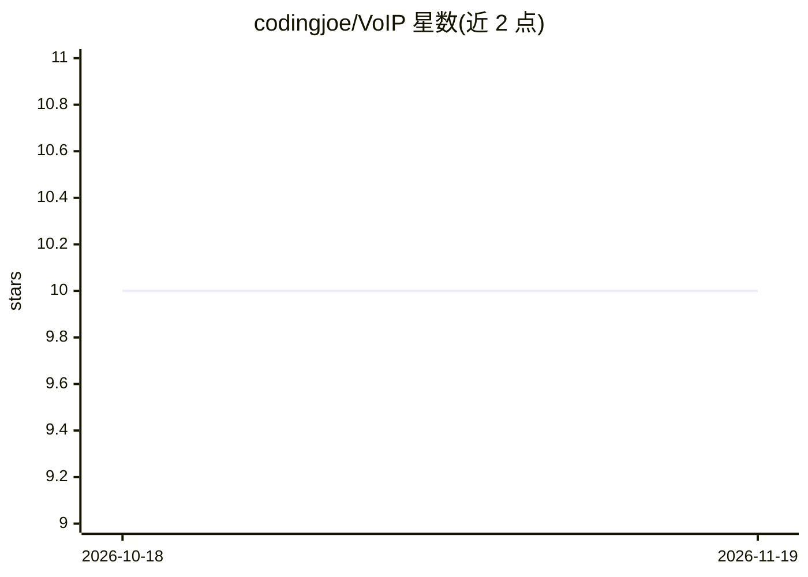

# codingjoe/VoIP

⭐ 10 · Python · AGPL-3.0 · 推送 2026-11-17 · [GitHub](https://github.com/codingjoe/VoIP) · [官网](https://codingjoe.dev/VoIP/) · 个人维护

**异步 Python VoIP 库，支持语音转录与 AI 语音通话**

异步 Python VoIP/SIP 库，支持通过 SIP 账号收发语音通话（默认 UDP 5060，可配置 TCP/TLS）。提供三种使用方式：CLI 命令（echo 通话、语音拨号播报、连接本地 agent 对话）、内置 MCP 服务器供任意 MCP 客户端代拨电话、Python API（子类化 TranscribeCall 处理转录结果或 AudioCall 获取原始音频）。需已有 SIP 账号；与 Ollama 配合可运行本地 agent；处于早期开发阶段，可能存在破坏性变更。

## 筛选速览

| 维度 | 判定 | 备注 |
|---|---|---|
| AI 角色 | `ai-native` | 本体是模型或模型工具 |
| 许可风险 | `viral` | AGPL-3.0 |
| 部署形态 | `library` | 以包/库形式分发 |
| 模型依赖 | local-ok | 支持本地模型 |
| 硬件要求 | — | 无带数字的原话,不猜 |
| 安装摩擦 | `low` | 无编译、无系统依赖或容器化 |
| 成熟度 | `idea` | |

## 能力要点

- CLI 支持 echo 通话、拨号播报语音与本地 agent 对话
- 内置 MCP 服务器，暴露代拨电话工具给任意 MCP 客户端
- Python API 支持转录回调（TranscribeCall）与原始音频访问（AudioCall）
- SIP 传输可选 UDP/TCP/TLS

## 适用场景

- 接入 SIP 线路为电话接通后做语音转录处理
- 通过 MCP 让 AI 客户端代拨并播报电话
- 结合本地 Ollama 搭建语音对话 agent

## 场景标签

`语音 Agent` `语音识别` · 领域:对话与助手

## 证据(README 行号)

> L75: Subclass `TranscribeCall` and override `transcription_received` to handle results.
> L51: You can also talk to a local agent (needs [Ollama]):

## 星数曲线

2026-10-18 10 → 2026-11-19 10（+0）

---
*卡片 v1 · prompt 1.4 · 生成 2026-11-19 · 置信度 mid · 依据 README sha `31c03176d064` · [字段定义](../../DATASET.md)*
