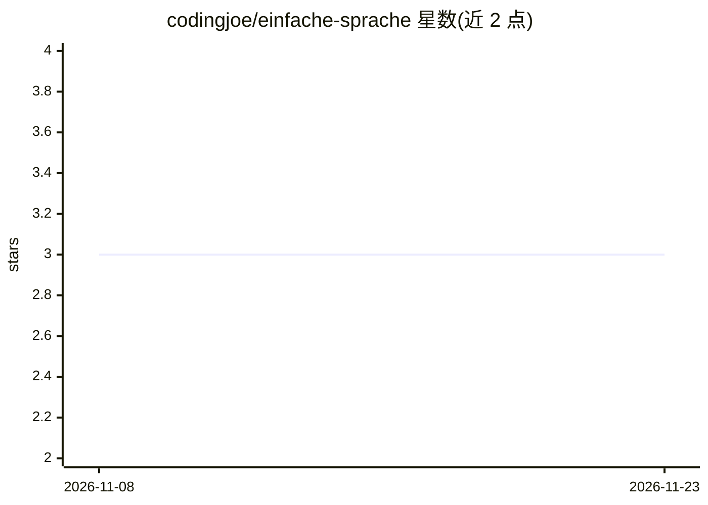

# codingjoe/einfache-sprache

⭐ 3 · Python · AGPL-3.0 · 推送 2026-11-17 · [GitHub](https://github.com/codingjoe/einfache-sprache) · 个人维护

**把德语文本改写为 DIN 8581-1 简易语言的 AI 技能**

一个以 SKILL.md 形式分发的 Agent 技能，将行政用语、专业术语的德语文本改写为符合 DIN 8581-1 简易语言的表述，内容保持不变、复杂概念以解释方式呈现。由 Prompt 与脚本组成，内置校验器反复检查直至无硬性违规，防止 Agent 编造规则。兼容 Claude Code、Cursor、VS Code Copilot 等支持 Agent Skills 格式的工具，通过 npx 或插件市场安装。规则内容整理自 DIN 8581-1 公开资料，未使用付费标准文本。

## 筛选速览

| 维度 | 判定 | 备注 |
|---|---|---|
| AI 角色 | `ai-native` | 本体是模型或模型工具 |
| 许可风险 | `viral` | AGPL-3.0 |
| 部署形态 | `library` | 以包/库形式分发 |
| 模型依赖 | — | README 未给出锁定关系 |
| 硬件要求 | — | 无带数字的原话,不猜 |
| 安装摩擦 | `low` | 无编译、无系统依赖或容器化 |
| 成熟度 | — | 结构信号不足 |

## 能力要点

- 按 DIN 8581-1 规则改写德语文本，保留关键信息（期限、金额、法律后果）
- 内置校验脚本，运行至无硬性规则违规为止，防止规则被编造
- SKILL.md 格式，兼容多种 Agent 编码工具
- 规则文本整理自 DIN 8581-1 的公开来源

## 适用场景

- 将政府公文（如社保通知）改写为无背景知识的读者首次阅读即可理解的文本
- 让 AI 助手按简易语言标准改写专业文档
- 为 Claude Code/Cursor 等 agent 工具添加德语简易化技能

## 场景标签

`AI 写作` · 领域:内容生成

## 证据(README 行号)

> L3: Ein AI-Skill, der deutsche Texte in **Einfache Sprache nach DIN 8581-1** bringt.
> L36: `SKILL.md` folgt dem Format von Agent Skills und passt in Claude Code, Cursor, VS Code Copilot, OpenAI Codex, Gemin

## 星数曲线

2026-11-08 3 → 2026-11-23 3（+0）

---
*卡片 v1 · prompt 1.4 · 生成 2026-11-22 · 置信度 high · 依据 README sha `d668bcb78085` · [字段定义](../../DATASET.md)*
