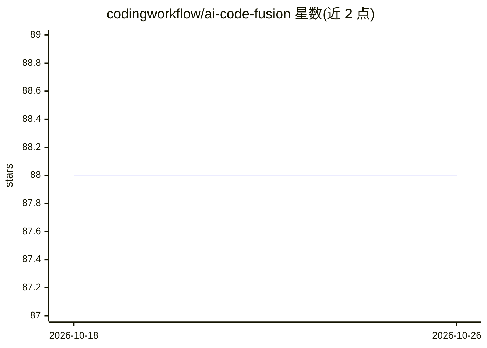

# codingworkflow/ai-code-fusion

⭐ 88 · TypeScript · GPL-3.0 · 推送 2026-10-25 · [GitHub](https://github.com/codingworkflow/ai-code-fusion) · [官网](https://www.codingworkflow.com/) · 个人维护

**桌面应用：把代码仓库内容合并为单个文件供 AI 工具使用**

Electron 桌面应用，面向需要将代码仓库喂给 AI 工具的用户：通过可视化目录浏览器选择代码文件，支持自定义过滤模式与 .gitignore，对所选文件进行 token 计数，生成可复制/导出的 Markdown 或 XML 格式整合文件。跨平台支持 Windows/macOS/Linux，GitHub Releases 提供安装包，也可用 Node.js 20+ 从源码构建，仓库含 Dev Container 配置。许可证为 GPL 3.0。

## 筛选速览

| 维度 | 判定 | 备注 |
|---|---|---|
| AI 角色 | `ai-ecosystem` | LLM/agent 周边工具 |
| 许可风险 | `viral` | GPL-3.0 |
| 部署形态 | `desktop` | 安装包/桌面程序 |
| 模型依赖 | — | README 未给出锁定关系 |
| 硬件要求 | — | 无带数字的原话,不猜 |
| 安装摩擦 | `low` | 无编译、无系统依赖或容器化 |
| 成熟度 | — | 结构信号不足 |

## 能力要点

- 可视化目录浏览器选择代码文件，支持自定义过滤模式与 .gitignore
- 所选文件的 token 计数
- 导出格式选择：Markdown 或 XML
- 跨平台（Windows/macOS/Linux），GitHub Releases 提供安装包

## 适用场景

- 把整个仓库打包成单个文件，粘贴给 ChatGPT/Claude 等 AI 工具分析
- 在提交给 AI 前统计 token 用量并筛选文件
- 以 Markdown 或 XML 格式导出代码上下文用于 AI 工作流

## 场景标签

 · 领域:开发者工具/AI 工作流

## 证据(README 行号)

> L5: A desktop app to prepare code repositories for AI workflows.
> L10: - Processed output ready to copy/export for AI tools

## 星数曲线

2026-10-18 88 → 2026-10-26 88（+0）

---
*卡片 v1 · prompt 1.4 · 生成 2026-10-23 · 置信度 high · 依据 README sha `47a581a44670` · [字段定义](../../DATASET.md)*
