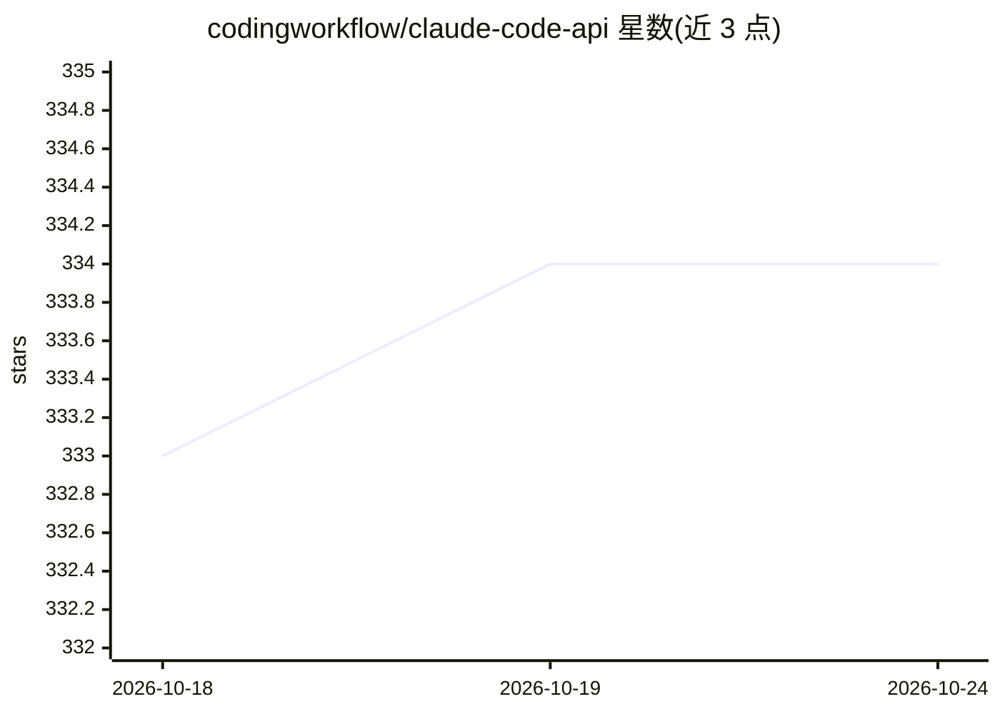

# codingworkflow/claude-code-api

⭐ 334 · Python · GPL-3.0 · 推送 2026-06-25 · [GitHub](https://github.com/codingworkflow/claude-code-api) · [官网](https://www.codingworkflow.com/) · 个人维护

**为 Claude Code CLI 提供 OpenAI 兼容接口的 API 网关**

将 Claude Code CLI 封装为 OpenAI 风格的 API 网关：提供 /v1/chat/completions、/v1/models 等 OpenAI 兼容端点，支持流式与非流式响应。模型字段可省略以使用 CLI 默认模型，支持 claude-opus-4-6 等模型的别名解析与被拒后降级重试（Opus 4.6 失败回退 Opus 4.5）。通过 git clone 加 make install 从源码安装，支持 Linux/macOS 与 Windows（bat 脚本，Windows 下可能需 WSL）。采用 GPL v3 许可。

## 筛选速览

| 维度 | 判定 | 备注 |
|---|---|---|
| AI 角色 | `ai-ecosystem` | LLM/agent 周边工具 |
| 许可风险 | `viral` | GPL-3.0 |
| 部署形态 | `None` |  |
| 模型依赖 | locked-api |  |
| 硬件要求 | — | 无带数字的原话,不猜 |
| 安装摩擦 | `medium` | 含编译或系统依赖之一 |
| 成熟度 | — | 结构信号不足 |

## 能力要点

- OpenAI 兼容端点（/v1/chat/completions、/v1/models）
- 流式与非流式 chat completions
- 模型别名解析与被拒后的降级重试逻辑
- 模型列表可通过 models.json 与环境变量覆盖配置

## 适用场景

- 让使用 OpenAI API 格式的客户端调用 Claude Code CLI
- 在已有 OpenAI 兼容工具链中接入 Claude 模型
- 统一管理 Claude 模型别名与回退策略

## 场景标签

`模型网关` · 领域:Agent 开发

## 证据(README 行号)

> L3: OpenAI-compatible API gateway for Claude Code CLI.
> L7: - OpenAI-style endpoints (`/v1/chat/completions`, `/v1/models`, sessions/projects APIs)

## 星数曲线

2026-10-18 333 → 2026-10-24 334（+1）

---
*卡片 v1 · prompt 1.4 · 生成 2026-10-21 · 置信度 high · 依据 README sha `3b654c7d6d5b` · [字段定义](../../DATASET.md)*
