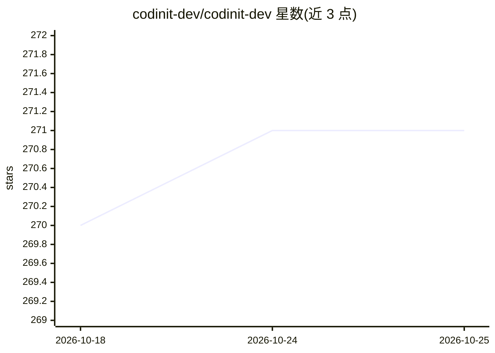

# codinit-dev/codinit-dev

⭐ 272 · TypeScript · MIT · 推送 2026-04-10 · [GitHub](https://github.com/codinit-dev/codinit-dev) · [官网](https://codinit.dev/download) · 组织维护

**开源本地优先的 AI 全栈应用构建平台，面向开发者**

CodinIT.dev 是开源的 AI 全栈开发平台，帮助开发者从浏览器或桌面端构建、管理与部署 Node.js 应用，把代码生成、项目管理与部署工具整合到单一工作流。支持 19 家以上云端与本地 AI 提供商（OpenAI、Anthropic、Ollama、LM Studio 等），可按任务动态切换；提供 Electron 桌面端（macOS/Windows/Linux 预构建包）、Docker 化部署及 Vercel/Netlify/GitHub Pages 预设配置，另含语义搜索、diff 可视化、文件并发锁等工具。

## 筛选速览

| 维度 | 判定 | 备注 |
|---|---|---|
| AI 角色 | `ai-ecosystem` | LLM/agent 周边工具 |
| 许可风险 | `permissive` | MIT |
| 部署形态 | `self-host` | docker 或自建部署 |
| 模型依赖 | local-ok | 支持本地模型 |
| 硬件要求 | — | 无带数字的原话,不猜 |
| 安装摩擦 | `low` | 无编译、无系统依赖或容器化 |
| 成熟度 | — | 结构信号不足 |

## 能力要点

- 代码生成 + 项目管理 + 部署的单工作流
- 19+ 云端与本地 AI 提供商接入，可按任务动态切换
- Web 与 Electron 桌面端双环境，Docker 化部署与 Vercel/Netlify/GitHub Pages 预设
- 集成 Supabase、实时数据可视化与语音命令接口

## 适用场景

- 通过 AI 快速生成与迭代 Node.js 全栈应用
- 在本地用 Ollama 等本地模型做原型实验
- 桌面端本地运行并部署到 Vercel/Netlify 等平台

## 场景标签

`代码生成` `编码 Agent` · 领域:编码与开发

## 证据(README 行号)

> L35: CodinIT.dev is an open‑source, AI full‑stack development platform designed to help developers build modern Node.js 
> L84: - **Universal Model Integration:** Seamlessly connect with over 19 cloud and local AI providers.
> L97: OpenAI, Anthropic, Google, Groq, xAI, DeepSeek, Cohere, Mistral, Together, Perplexity, HuggingFace, OpenRouter, and

## 星数曲线

2026-10-18 270 → 2026-10-25 271（+1）

---
*卡片 v1 · prompt 1.4 · 生成 2026-10-22 · 置信度 high · 依据 README sha `812b591ed693` · [字段定义](../../DATASET.md)*
