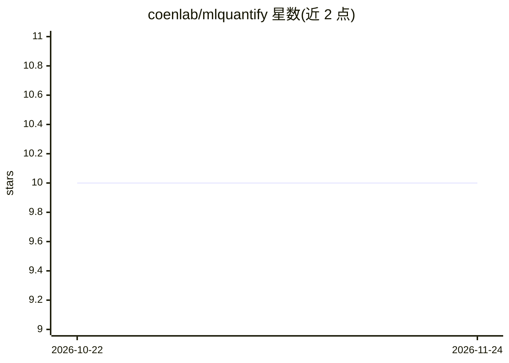

# coenlab/mlquantify

⭐ 10 · Python · BSD-3-Clause · 推送 2026-11-14 · [GitHub](https://github.com/coenlab/mlquantify) · [官网](https://coenlab.github.io/mlquantify/) · 个人维护

**面向 ML 研究者的类分布估计（quantification）Python 库**

mlquantify 是用于 quantification（supervised prevalence estimation）的 Python 库，目标是估计数据集中各类别的分布。提供多种量化方法、面向量化任务的模型选择、评估指标与协议（如 Artificial Prevalence Protocol）、校准工具、置信区域估计、可插拔求解器与表示方式以及可视化工具。核心依赖 scikit-learn/numpy/scipy 等随 pip 自动安装，PyTorch 供神经量化器（如 QuaNet）作为可选扩展。

## 筛选速览

| 维度 | 判定 | 备注 |
|---|---|---|
| AI 角色 | `ai-native` | 本体是模型或模型工具 |
| 许可风险 | `permissive` | BSD-3-Clause |
| 部署形态 | `library` | 以包/库形式分发 |
| 模型依赖 | — | README 未给出锁定关系 |
| 硬件要求 | — | 无带数字的原话,不猜 |
| 安装摩擦 | `low` | 无编译、无系统依赖或容器化 |
| 成熟度 | — | 结构信号不足 |

## 能力要点

- 多种量化方法与量化任务专用的模型选择
- APP（Artificial Prevalence Protocol）等评估协议与指标
- 校准、置信区域估计与可插拔求解器/表示
- 可选 [neural] 扩展支持 QuaNet 等神经量化器

## 适用场景

- 估计数据集中各类别的先验分布（prevalence estimation）
- 在先验偏移/协变量偏移的合成数据上评估量化模型
- 为量化任务对比不同方法并可视化结果

## 场景标签

 · 领域:机器学习/量化估计

## 证据(README 行号)

> L7:  A Python Package for Quantification
> L11:  **mlquantify** is a Python library for quantification, also known as supervised prevalence estimation, designed to

## 星数曲线

2026-10-22 10 → 2026-11-24 10（+0）

---
*卡片 v1 · prompt 1.4 · 生成 2026-11-19 · 置信度 high · 依据 README sha `7522c645572a` · [字段定义](../../DATASET.md)*
