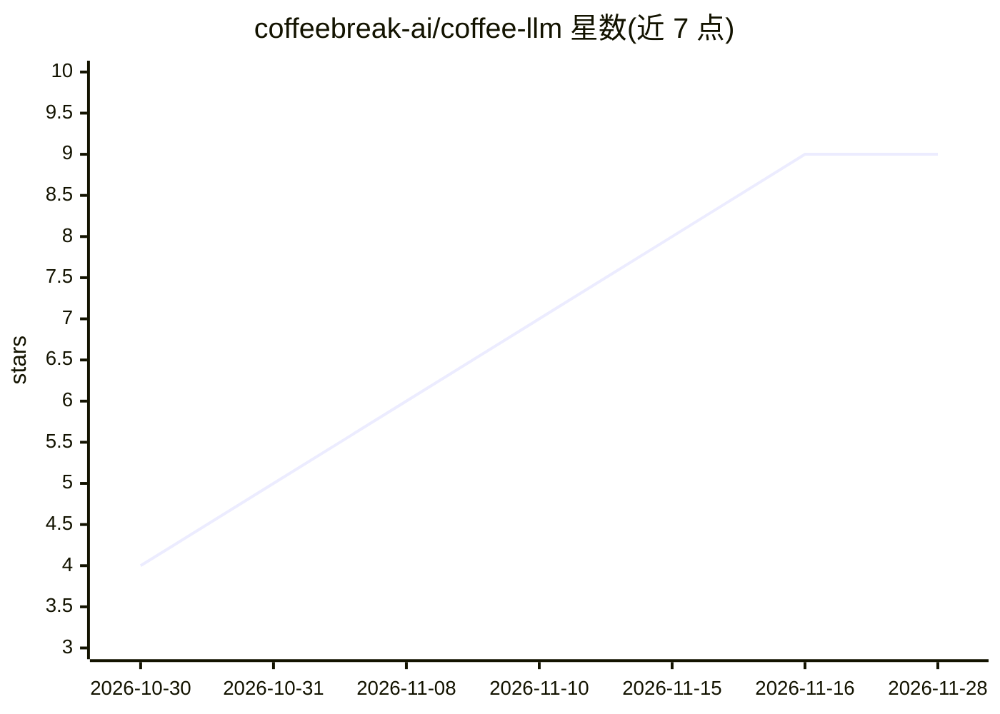

# coffeebreak-ai/coffee-llm

⭐ 9 · Python · MIT · 推送 2026-11-17 · [GitHub](https://github.com/coffeebreak-ai/coffee-llm) · 个人维护

**面向个人开发者的 LLM 网关：压缩上下文以节省昂贵模型的输入 token**

部署在昂贵模型前方的个人网关，向 Cursor/Codex 以 OpenAI 兼容接口提供名为 Coffee LLM 的单一入口。核心机制是专家–助手模式：廉价助手模型负责数据收集、搜索与追问，昂贵专家模型只接收压缩后的判断材料并撰写最终回答；三级访问权限只升不降，调节器决定升级（含置信度阈值 0.80）。要求 Python 3.15+，无第三方依赖，需 OPENAI_API_KEY，默认调节器经本地 Ollama 运行。

## 筛选速览

| 维度 | 判定 | 备注 |
|---|---|---|
| AI 角色 | `ai-ecosystem` | LLM/agent 周边工具 |
| 许可风险 | `permissive` | MIT |
| 部署形态 | `None` |  |
| 模型依赖 | local-ok | 支持本地模型 |
| 硬件要求 | — | 无带数字的原话,不猜 |
| 安装摩擦 | `low` | 无编译、无系统依赖或容器化 |
| 成熟度 | — | 结构信号不足 |

## 能力要点

- 专家–助手分工路由，三级访问权限只升不降
- 稳定前缀保持 provider 缓存命中，历史仅追加
- 结果片段超 12,000 字符时由 deflate 机制压缩，完整结果按 source_id 可取回
- 以 OpenAI 兼容 Base URL 接入 Cursor 与 Codex

## 适用场景

- 在 Cursor/Codex 中降低昂贵模型的每任务输入 token 开销
- 让廉价助手模型承担读取、检索等中间步骤
- 本地运行一个可自定模型分工的对话网关

## 场景标签

`模型网关` · 领域:Agent 开发

## 证据(README 行号)

> L11: A personal gateway in front of an expensive model. In Cursor and Codex the model is named `Coffee LLM`. In code and
> L42: At level 2 the expert may assign several independent tasks in one reply. Each one is a separate `gateway_assistant`
> L85: Python 3.15 or newer is required. `pyproject.toml` has no third-party dependencies, so a `pip` install is not neede

## 星数曲线

2026-10-30 4 → 2026-11-28 9（+5）

---
*卡片 v1 · prompt 1.4 · 生成 2026-11-20 · 置信度 high · 依据 README sha `31e460992e01` · [字段定义](../../DATASET.md)*
