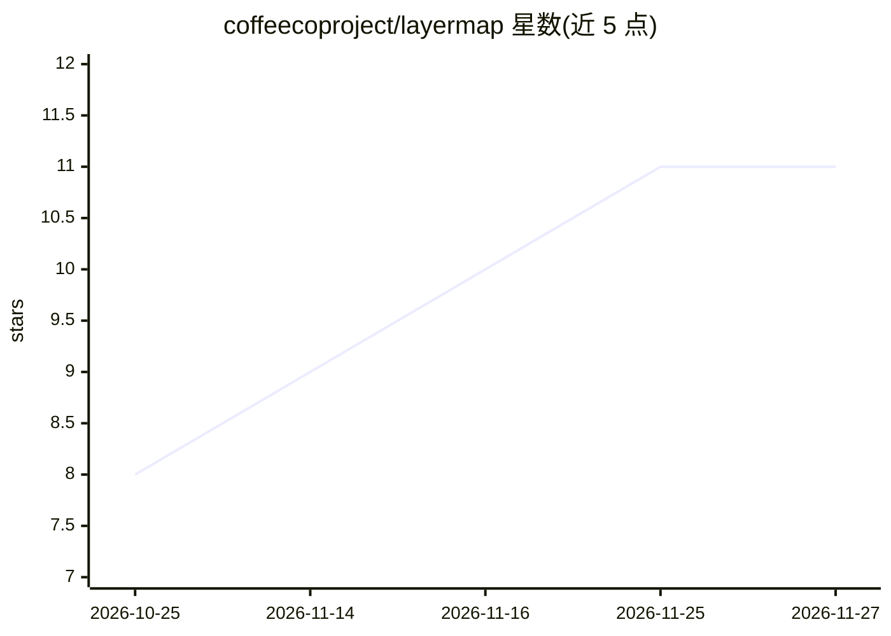

# coffeecoproject/layermap

⭐ 11 · TypeScript · Apache-2.0 · 推送 2026-11-25 · [GitHub](https://github.com/coffeecoproject/layermap) · [官网](https://www.npmjs.com/package/layermap) · 组织维护

**为编码 agent 提供代码调用图谱的 MCP 服务器与 CLI**

LayerMap 以各语言的编译器/类型检查器解析调用关系（非 tree-sitter 名称猜测），为 TypeScript、JavaScript、Go、Python、Java 项目构建分层调用图：一次调用返回函数的调用者/被调用者，最深 8 层并可追溯到 HTTP 路由、处理器、任务与命令；变更检查工具列出未提交改动影响的端点与相关测试。以 MCP 服务器（stdio）、CLI 及 Claude Code、Codex、CodeBuddy Code、Pi、DeepSeek Harness 插件形式分发，本地运行、不外发数据。需要 Node.js 22.22+ 与 Git 仓库。

## 筛选速览

| 维度 | 判定 | 备注 |
|---|---|---|
| AI 角色 | `ai-ecosystem` | LLM/agent 周边工具 |
| 许可风险 | `permissive` | Apache-2.0 |
| 部署形态 | `library` | 以包/库形式分发 |
| 模型依赖 | — | README 未给出锁定关系 |
| 硬件要求 | — | 无带数字的原话,不猜 |
| 安装摩擦 | `medium` | 含编译或系统依赖之一 |
| 成熟度 | — | 结构信号不足 |

## 能力要点

- 调用链由各语言编译器解析，覆盖接口、基类、模板与装饰器
- 一次调用返回最多 8 层调用者并映射到 HTTP 路由
- project_check_changes 列出改动影响的路由、任务与相关测试
- MCP 服务器、CLI 与 5 个编码 agent 的插件多种安装方式

## 适用场景

- 让编码 agent 一次调用即知改某函数影响哪些 HTTP 端点
- 提交前检查未提交改动波及的路由、任务与测试
- 在微信小程序代码中将页面模板与绑定方法关联起来

## 场景标签

`编码 Agent` · 领域:编码与开发

## 证据(README 行号)

> L19: A layered map of your codebase for coding agents. LayerMap gives Claude Code, Codex, CodeBuddy
> L30: It maps **TypeScript, JavaScript, Go, Python and Java** with each language's own compiler, so calls
> L185: remove …` undoes it. For any other MCP client, run `npx -y layermap mcp` as a stdio server in the

## 星数曲线

2026-10-25 8 → 2026-11-27 11（+3）

---
*卡片 v1 · prompt 1.4 · 生成 2026-11-19 · 置信度 high · 依据 README sha `25d3c9db4e99` · [字段定义](../../DATASET.md)*
