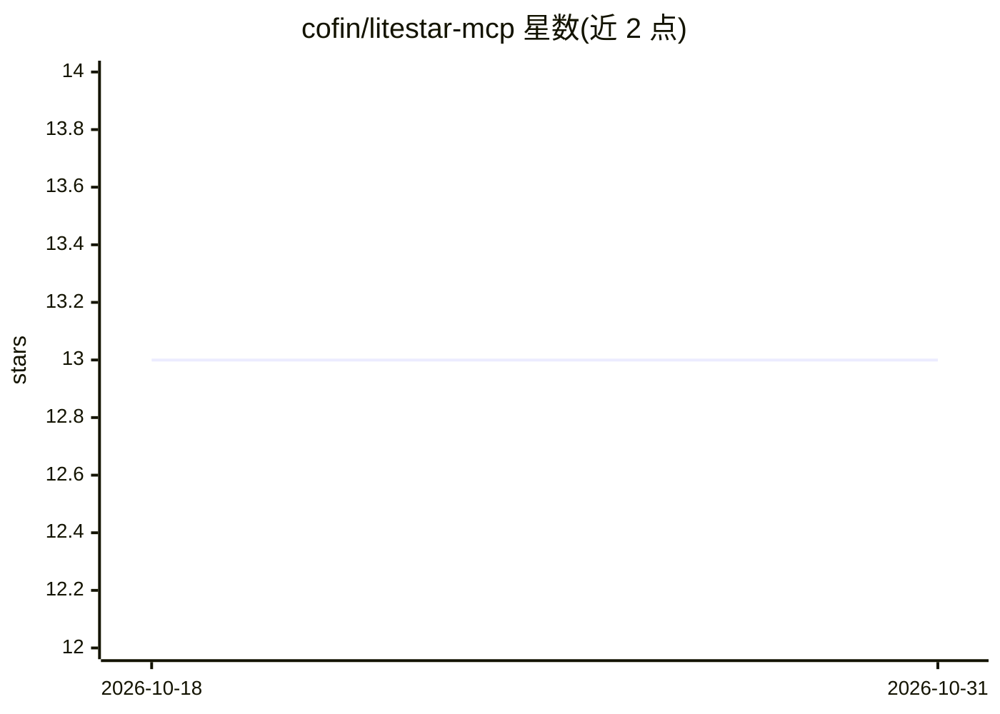

# cofin/litestar-mcp

⭐ 13 · Python · MIT · 推送 2026-10-19 · [GitHub](https://github.com/cofin/litestar-mcp) · [官网](https://cofin.github.io/litestar-mcp/) · 个人维护

**把 Litestar 路由暴露为 MCP 工具/资源/提示词的插件**

面向 Litestar 开发者的 Python 插件：在路由装饰器上直接传 mcp_tool / mcp_resource / mcp_prompt 关键字参数，即可在应用初始化时自动发现并将这些路由通过 MCP Streamable HTTP 与 JSON-RPC 暴露给 AI agent。支持 RFC 6570 URI 模板资源、独立 prompt 注册、msgspec 工具参数校验、继承应用自身的 Litestar 认证中间件，以及可选的 Tasks、Agent Skills、A2A 1.0 扩展。另提供独立 MCP 类与 stdio / bridge 运行方式。MIT 许可。

## 筛选速览

| 维度 | 判定 | 备注 |
|---|---|---|
| AI 角色 | `ai-ecosystem` | LLM/agent 周边工具 |
| 许可风险 | `permissive` | MIT |
| 部署形态 | `library` | 以包/库形式分发 |
| 模型依赖 | — | README 未给出锁定关系 |
| 硬件要求 | — | 无带数字的原话,不猜 |
| 安装摩擦 | `low` | 无编译、无系统依赖或容器化 |
| 成熟度 | — | 结构信号不足 |

## 能力要点

- 路由装饰器直接标记即暴露为 MCP tools/resources/prompts，自动发现
- MCP Streamable HTTP + JSON-RPC 传输，含 stdio 与 bridge 模式
- 继承应用现有 Litestar 认证中间件，支持 litestar-security 策略
- 可选 MCP Tasks、Agent Skills、A2A 1.0 扩展

## 适用场景

- 为已有 Litestar Web 应用快速挂载 MCP 服务端点
- 构建独立 MCP 服务器供桌面 AI 客户端通过 stdio 调用
- 把业务接口以工具/资源形式提供给 AI agent 使用

## 场景标签

 · 领域:AI agent 基础设施/Python Web 框架插件

## 证据(README 行号)

> L3: A lightweight plugin that integrates Litestar web applications with the Model Context Protocol (MCP) by exposing mar
> L11: This plugin automatically discovers Litestar routes marked for MCP and exposes them through an MCP-native transport

## 星数曲线

2026-10-18 13 → 2026-10-31 13（+0）

---
*卡片 v1 · prompt 1.4 · 生成 2026-10-31 · 置信度 high · 依据 README sha `a2cf00494276` · [字段定义](../../DATASET.md)*
