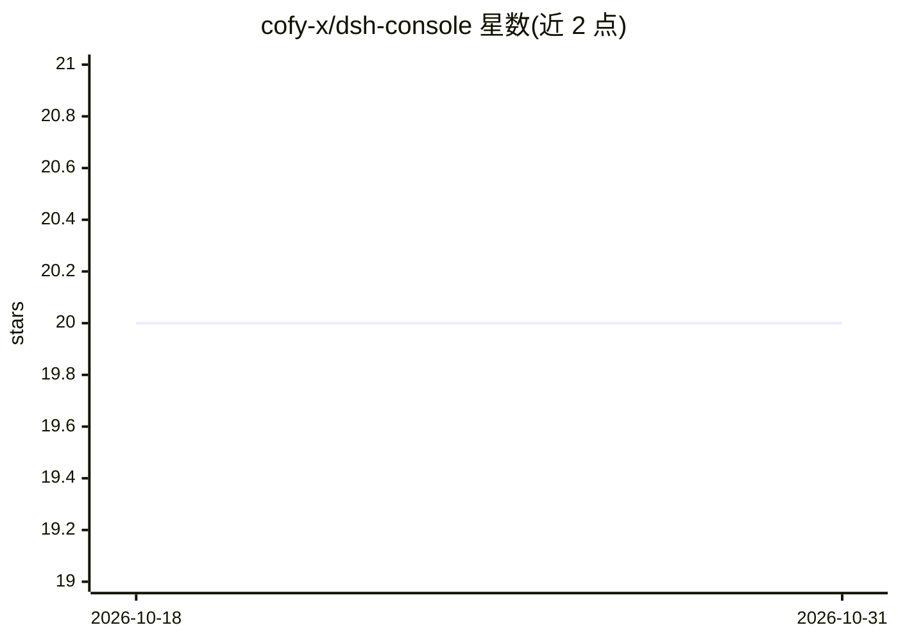

# cofy-x/dsh-console

⭐ 20 · TypeScript · Apache-2.0 · 推送 2026-10-23 · [GitHub](https://github.com/cofy-x/dsh-console) · [官网](https://dsh-console.cofy-x.space) · 组织维护 · 中文 README

**DeepSeek Harness 的原生终端工作台（TUI 客户端）**

基于 React/Ink 的键盘优先终端界面，接入 DeepSeek Harness（DSH）运行 agent：DSH 负责模型、provider、会话、工具与审批，Console 负责终端交互与展示。提供流式多轮对话、可恢复的持久会话与分支、工具/技能目录、子代理与计划视图、本地 shell 模式。通过 npm 全局安装，需 Node.js 24+ 与 pnpm；当前为公开预发布版（0.1.0-rc.x），部分功能（跨目录会话搜索、通用附件、Web UI）尚未提供。

## 筛选速览

| 维度 | 判定 | 备注 |
|---|---|---|
| AI 角色 | `ai-ecosystem` | LLM/agent 周边工具 |
| 许可风险 | `permissive` | Apache-2.0 |
| 部署形态 | `library` | 以包/库形式分发 |
| 模型依赖 | locked-api |  |
| 硬件要求 | — | 无带数字的原话,不猜 |
| 安装摩擦 | `low` | 无编译、无系统依赖或容器化 |
| 成熟度 | `idea` | |

## 能力要点

- 持久 DSH 会话：搜索、预览、恢复与分支（fork）
- 结构化工具调用、审批流与 /tools、/skills 目录浏览
- 本地 shell 模式（!command 不提交给模型）
- 通过 DSH 附件服务接入图片输入，失败不静默降级

## 适用场景

- 在终端中以键盘操作运行和观察 DSH agent 会话
- 恢复或分支历史会话继续工作
- 检查和管理 agent 工具、技能与后台任务

## 场景标签

`AI 助手` · 领域:对话与助手

## 证据(README 行号)

> L5: DSH Console is a keyboard-first, DSH-native terminal workbench for DeepSeek Harness. It combines durable sessions, s
> L95: DeepSeek Harness owns agent execution, models, provider settings and credentials, sessions, tools, approvals, attac

## 星数曲线

2026-10-18 20 → 2026-10-31 20（+0）

---
*卡片 v1 · prompt 1.4 · 生成 2026-10-28 · 置信度 high · 依据 README sha `f922ca6f8ff1` · [字段定义](../../DATASET.md)*
