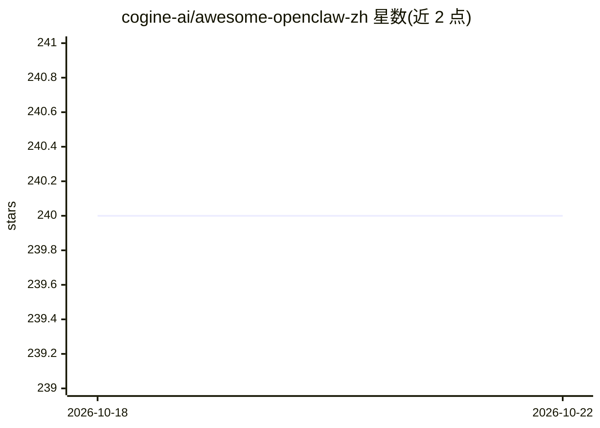

# cogine-ai/awesome-openclaw-zh

⭐ 240 · HTML · MIT · 推送 2026-10-11 · [GitHub](https://github.com/cogine-ai/awesome-openclaw-zh) · [官网](https://opcboost.com) · 组织维护 · 中文 README

**面向中文用户的 OpenClaw 实战案例库：部署、接入与场景案例**

由 Cogine 团队整理维护的 OpenClaw 中文实践仓库，覆盖三类内容：部署与配置（Mac/Windows/Linux VPS/多 Agent）、渠道接入（飞书、钉钉、企业微信、QQ）、以及 203 个来源可追溯的使用案例，按社交媒体、生产力、DevOps、数据分析等 14+ 分类组织，并标注每个案例的来源、前置条件、产物与验证状态。案例包含晨间简报、个人知识库（RAG）、多智能体团队、社交媒体监控等，原创方案标记为实验。提供在线阅读与搜索站点及 Issue 投稿通道。

## 筛选速览

| 维度 | 判定 | 备注 |
|---|---|---|
| AI 角色 | `ai-knowledge` | 知识聚合/清单类 |
| 许可风险 | `permissive` | MIT |
| 部署形态 | `None` |  |
| 模型依赖 | — | README 未给出锁定关系 |
| 硬件要求 | — | 无带数字的原话,不猜 |
| 安装摩擦 | `low` | 无编译、无系统依赖或容器化 |
| 成熟度 | — | 结构信号不足 |

## 能力要点

- 203 个来源可追溯的使用案例与工作流
- 覆盖 Mac/Windows/Linux VPS 部署与飞书、钉钉、企业微信、QQ 渠道接入
- 14+ 分类导航与 7 天上手路径
- 每个案例标注来源、前置条件、产物与验证状态

## 适用场景

- 中文用户按步骤完成 OpenClaw 部署与渠道接入
- 按分类查找自动化、内容创作、数据分析等场景案例
- 不会提交 PR 的用户通过 Issue 分享自己跑通的案例

## 场景标签

 · 领域:AI Agent 知识聚合

## 证据(README 行号)

> L3: 一个面向中文用户的 OpenClaw 开源仓库：
> L14: - 使用场景：203 个来源可追溯的案例、工作流与原创实验
> L66: - 全量用例索引（203）

## 星数曲线

2026-10-18 240 → 2026-10-22 240（+0）

---
*卡片 v1 · prompt 1.4 · 生成 2026-10-22 · 置信度 high · 依据 README sha `60d89767c5e9` · [字段定义](../../DATASET.md)*
