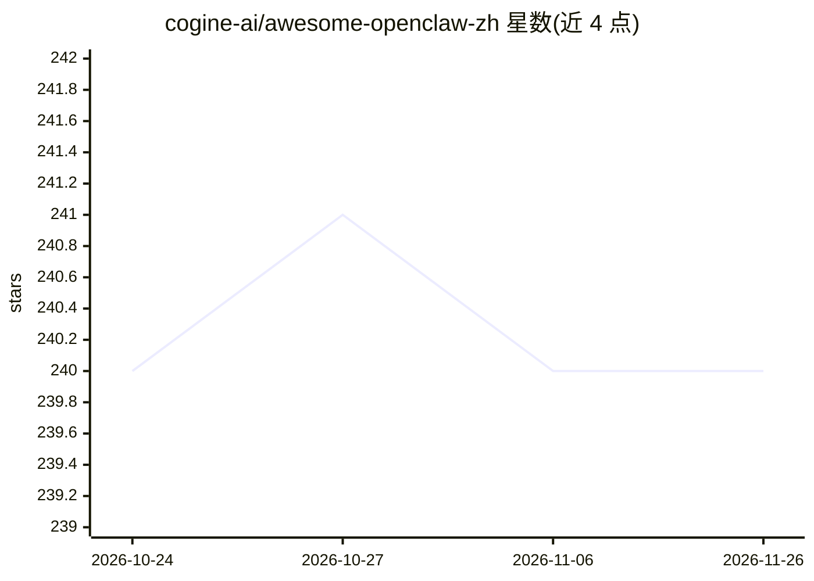

# cogine-ai/awesome-openclaw-zh

⭐ 240 · HTML · MIT · 推送 2026-11-06 · [GitHub](https://github.com/cogine-ai/awesome-openclaw-zh) · [官网](https://opcboost.com) · 组织维护 · 中文 README

**OpenClaw 中文使用案例库：部署、接入与可复现工作流**

由 Cogine 团队整理维护的 OpenClaw 中文实践资料库，覆盖三类内容：部署与配置（Mac/Windows WSL2/Linux VPS/多 Agent）、渠道接入（飞书、钉钉、企业微信、QQ）以及 218 个标注来源的用例、工作流与原创实验，含周报整理、AI 编程协作等主题。面向已在或准备将 OpenClaw 用于中文办公场景的用户；精选成果附输入、复现脚本与 ZIP 材料包。本仓库为文档型清单，不提供自身安装方式，用例来自自建实践与多个开源仓库的收录。

## 筛选速览

| 维度 | 判定 | 备注 |
|---|---|---|
| AI 角色 | `ai-knowledge` | 知识聚合/清单类 |
| 许可风险 | `permissive` | MIT |
| 部署形态 | `None` |  |
| 模型依赖 | — | README 未给出锁定关系 |
| 硬件要求 | — | 无带数字的原话,不猜 |
| 安装摩擦 | `low` | 无编译、无系统依赖或容器化 |
| 成熟度 | — | 结构信号不足 |

## 能力要点

- 218 个来源可追溯的用例按 14 个分类组织（生产力、数据分析、安全监控等）
- 提供飞书/企业微信/钉钉/QQ 渠道接入教程
- 部署指南覆盖 macOS、Windows (WSL2) 与 Linux VPS
- 精选案例附输入、运行步骤与 ZIP 材料包

## 适用场景

- 我想把 OpenClaw 接入飞书或企业微信，在机器人对话里整理周报
- 我需要多平台部署 OpenClaw 的中文步骤指引
- 我想找可复制的中文工作流案例并跑通自己的版本

## 场景标签

`精选清单` `教程课程` · 领域:学习与行业

## 证据(README 行号)

> L1: # OpenClaw 中文最佳实践库（awesome-openclaw-zh）
> L21: - 使用场景：218 个来源可追溯的案例、工作流与原创实验

## 星数曲线

2026-10-24 240 → 2026-11-26 240（+0）

---
*卡片 v1 · prompt 1.4 · 生成 2026-11-25 · 置信度 high · 依据 README sha `255da6bb71a8` · [字段定义](../../DATASET.md)*
