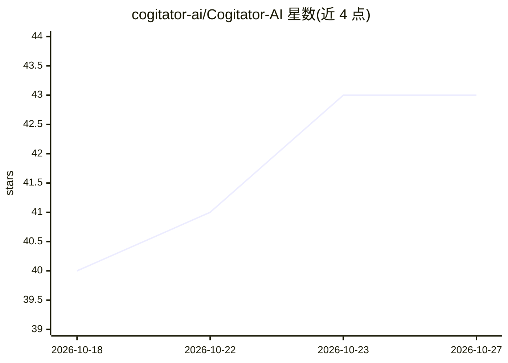

# cogitator-ai/Cogitator-AI

⭐ 43 · TypeScript · MIT · 推送 2026-10-26 · [GitHub](https://github.com/cogitator-ai/Cogitator-AI) · [官网](https://cogitator.app) · 组织维护

**面向工程团队的自托管 TypeScript LLM Agent 运行时**

Cogitator 是运行在自有基础设施上的 TypeScript LLM Agent 运行时，核心包含 Agent、Zod 类型化工具与 12 个 LLM 提供商后端（含 Ollama 本地模型）。能力覆盖 7 种 swarm 策略、基于 Redis/Postgres 检查点的持久化 DAG 工作流、带审批的工具调用、6 种存储后端的记忆与 RAG、Docker/WASM 沙箱执行，以及 MCP 客户端/服务端与 Google A2A 协议双向支持。附带 Cogitator Studio 本地调试界面展示 trace、成本与审批，按 npm 分包发布，MIT 许可。README 含与 Mastra、LangChain.js、Vercel AI SDK、OpenAI Agents SDK 的功能对比表。

## 筛选速览

| 维度 | 判定 | 备注 |
|---|---|---|
| AI 角色 | `ai-ecosystem` | LLM/agent 周边工具 |
| 许可风险 | `permissive` | MIT |
| 部署形态 | `self-host` | docker 或自建部署 |
| 模型依赖 | local-ok | 支持本地模型 |
| 硬件要求 | — | 无带数字的原话,不猜 |
| 安装摩擦 | `low` | 无编译、无系统依赖或容器化 |
| 成熟度 | — | 结构信号不足 |

## 能力要点

- 12 个内置 LLM 提供商（OpenAI/Anthropic/Google/Ollama 等），改模型字符串即可切换
- 持久化 DAG 工作流：检查点、审批、定时器存于 Redis/Postgres，重启后可恢复
- Docker 与 WASM 沙箱执行不可信代码，含 18 个预构建 WASM 工具
- MCP 客户端/服务端与 A2A 协议双向支持，OpenAI 兼容 API

## 适用场景

- 搭建带记忆与 RAG 的多 Agent 协作（swarm）系统
- 构建跨重启可恢复、含人工审批节点的数据处理工作流
- 通过 MCP/A2A/REST 等协议把 Agent 暴露为服务供多用户调用
- 自托管运行接入 Telegram、Discord、Slack 等渠道的个人 AI 助手

## 场景标签

`Agent 框架` `多智能体` `Agent 记忆` · 领域:Agent 开发

## 证据(README 行号)

> L22: Cogitator is a TypeScript runtime for LLM agents that runs on your own infrastructure. Start with one agent and a c
> L24: It works with 12 providers, from OpenAI, Anthropic and Google to local models through Ollama, and `@cogitator-ai/co

## 星数曲线

2026-10-18 40 → 2026-10-27 43（+3）

---
*卡片 v1 · prompt 1.4 · 生成 2026-10-25 · 置信度 mid · 依据 README sha `8365a7c50ca4` · [字段定义](../../DATASET.md)*
