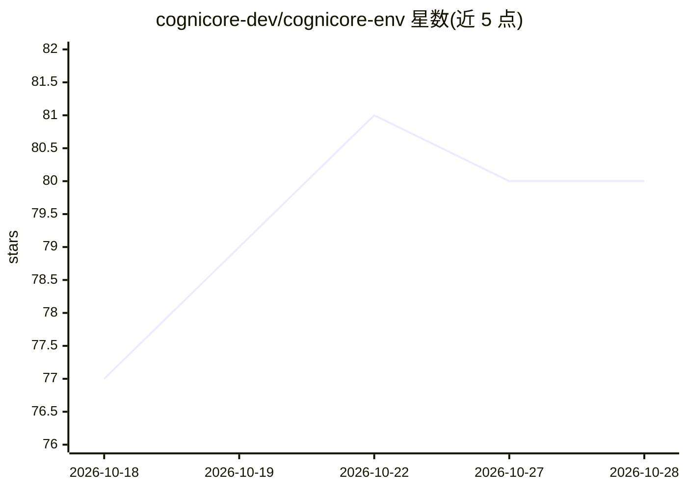

# cognicore-dev/cognicore-env

⭐ 81 · Python · MIT · 推送 2026-10-21 · [GitHub](https://github.com/cognicore-dev/cognicore-env) · [官网](https://www.cognicoree.tech/) · 组织维护

**给 AI agent 的持久记忆、反思与安全层 Python 库**

面向 AI agent 开发者的记忆与反思基础设施库：跨会话存储经验（包括失败的尝试）、按语义召回、从重复失败中提炼教训、在输入到达 agent 前拦截提示注入。默认零强制依赖、进程内运行，检索采用 BM25 加多跳图遍历（可选语义检索 extra）。提供 MCP server（含托管端点，OAuth 2.1 登录）供 Claude Code、Cursor 等客户端接入，附带 mem0 迁移、CLI、回放分支及可选 RL 训练组件。已知限制：词法检索在会话词汇与查询差异大时失效。

## 筛选速览

| 维度 | 判定 | 备注 |
|---|---|---|
| AI 角色 | `ai-ecosystem` | LLM/agent 周边工具 |
| 许可风险 | `permissive` | MIT |
| 部署形态 | `library` | 以包/库形式分发 |
| 模型依赖 | — | README 未给出锁定关系 |
| 硬件要求 | — | 无带数字的原话,不猜 |
| 安装摩擦 | `low` | 无编译、无系统依赖或容器化 |
| 成熟度 | — | 结构信号不足 |

## 能力要点

- 零强制依赖，进程内运行，无需向量库与嵌入服务
- BM25 + 多跳图检索适配 LongMemEval 多会话证据组合
- NexusShield 在提示注入到达 agent 前拦截
- MCP server（含托管端点）与 Claude 插件、mem0 签名导入导出

## 适用场景

- 让我的编码 agent 记住上次会话中已失败与已验证的方案
- 为 MCP 客户端（Claude Code/Cursor）接入持久记忆而无需改代码
- 在 agent 前置拦截提示注入与越狱尝试
- 跨环境迁移经过签名验证的记忆数据

## 场景标签

`Agent 记忆` `网络安全` · 领域:Agent 开发

## 证据(README 行号)

> L21: CogniCore is a memory and reflection layer that keeps it. It runs in-process, on plain Python —
> L64: |**MCP server**|Use CogniCore from Claude Code, Cursor and any other MCP-compatible client|

## 星数曲线

2026-10-18 77 → 2026-10-28 80（+3）

---
*卡片 v1 · prompt 1.4 · 生成 2026-10-24 · 置信度 high · 依据 README sha `2ac0b9e7b2fd` · [字段定义](../../DATASET.md)*
