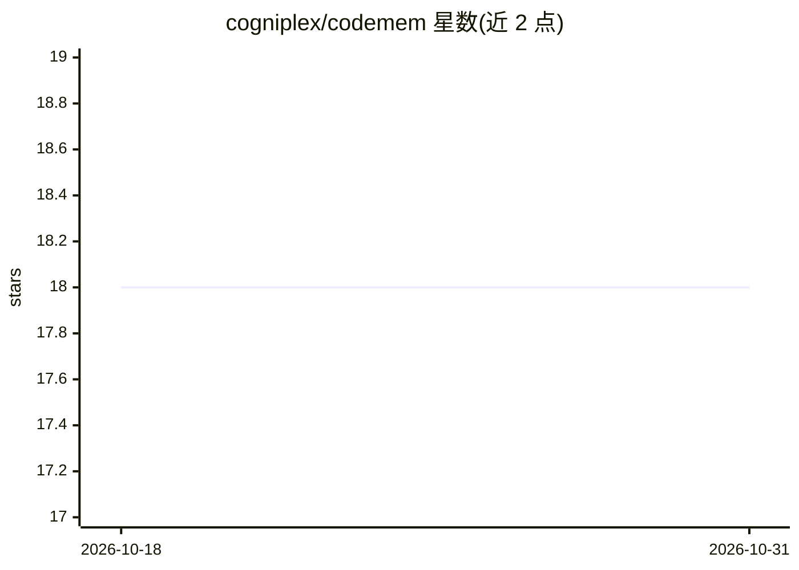

# cogniplex/codemem

⭐ 18 · Rust · Apache-2.0 · 推送 2026-07-25 · [GitHub](https://github.com/cogniplex/codemem) · 组织维护

**给 AI 编程助手的代码库记忆引擎，跨会话保留探索结果**

面向 AI 编程助手（Claude Code、Cursor、Windsurf）的 Rust 单二进制记忆引擎：将代码库与助手交互构建为持久知识图谱（tree-sitter 索引 14 种语言，可选 SCIP 索引器提供编译器级交叉引用），通过 32 个 MCP 工具提供时序查询、diff 爆炸半径分析、代码审查等能力；记忆检索采用 9 成分混合评分（向量、图强度、BM25 等），嵌入模型默认本地 Candle（约 440MB 一次性下载），可选 Ollama/OpenAI 兼容 API/Gemini；存储目前为 SQLite。

## 筛选速览

| 维度 | 判定 | 备注 |
|---|---|---|
| AI 角色 | `ai-ecosystem` | LLM/agent 周边工具 |
| 许可风险 | `permissive` | Apache-2.0 |
| 部署形态 | `library` | 以包/库形式分发 |
| 模型依赖 | local-ok | 支持本地模型 |
| 硬件要求 | — | 无带数字的原话,不猜 |
| 安装摩擦 | `high` | 编译与系统依赖俱全 |
| 成熟度 | — | 结构信号不足 |

## 能力要点

- 图-向量混合架构：HNSW 向量检索 + 知识图谱（PageRank、社区检测等）
- 32 个 MCP 工具与 9 个生命周期钩子，会话启动自动注入先前知识
- diff 爆炸半径分析与风险评分，5 个时序查询工具
- 本地嵌入模型（Candle BERT）默认离线运行，无需 API key

## 适用场景

- 让编程助手跨会话记住代码库探索结果与架构决策
- 合并前评估代码改动的影响范围与风险
- 查询代码库在时间维度上的变更与架构漂移

## 场景标签

`知识图谱` `Agent 记忆` `代码审查` · 领域:Agent 开发

## 证据(README 行号)

> L8: A standalone Rust memory engine for AI coding assistants. Single binary, zero runtime deps.
> L59: Downloads the local embedding model (~440MB, one-time), registers lifecycle hooks, and configures the MCP server fo

## 星数曲线

2026-10-18 18 → 2026-10-31 18（+0）

---
*卡片 v1 · prompt 1.4 · 生成 2026-10-29 · 置信度 mid · 依据 README sha `47a90aa9ed84` · [字段定义](../../DATASET.md)*
