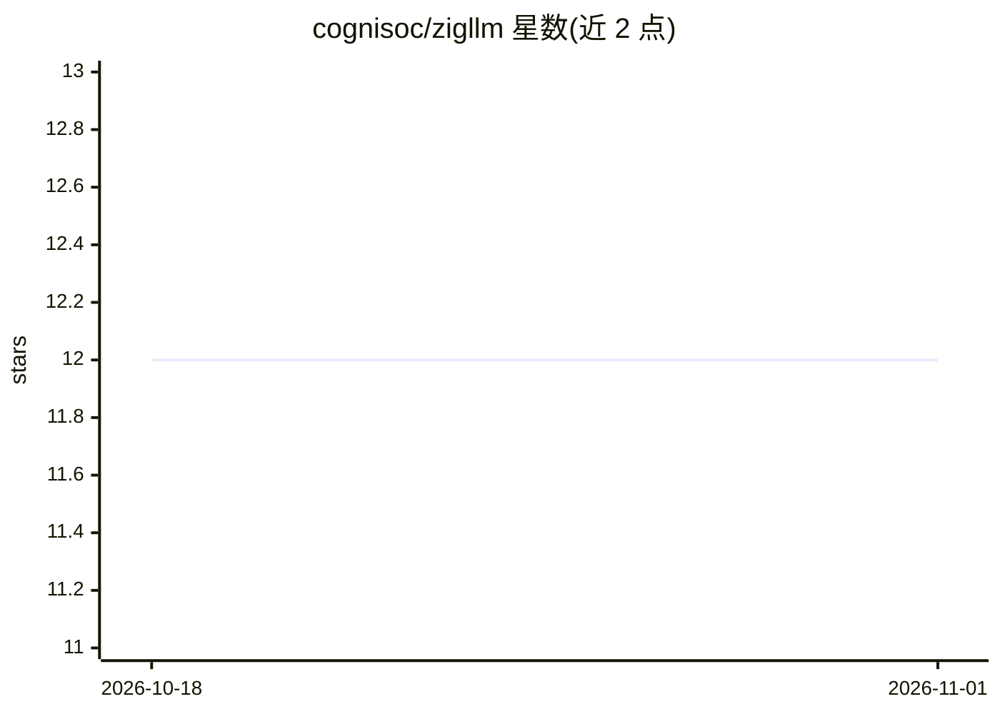

# cognisoc/zigllm

⭐ 12 · Zig · MIT · 推送 2026-07-02 · [GitHub](https://github.com/cognisoc/zigllm) · [官网](https://zigllm.cognisoc.com) · 组织维护

**用 Zig 从张量到文本生成实现 LLM 的教学项目**

教育性质的 transformer 架构实现：以 6 个递进层（张量/内存 → 线性代数与量化 → 神经原语 → transformer 块 → 18 个模型家族 → 推理与采样）组织代码，每个组件附带讲解文档，285+ 测试作为可执行文档。实现 LLaMA、Mistral、GPT-2、Mamba、BERT 等 18 种架构，支持 GGUF 格式加载（兼容 llama.cpp 生态模型）、18+ 种量化格式与多种采样策略。需 Zig 0.14+，从源码构建运行。

## 筛选速览

| 维度 | 判定 | 备注 |
|---|---|---|
| AI 角色 | `ai-native` | 本体是模型或模型工具 |
| 许可风险 | `permissive` | MIT |
| 部署形态 | `None` |  |
| 模型依赖 | local-ok | 支持本地模型 |
| 硬件要求 | — | 无带数字的原话,不猜 |
| 安装摩擦 | `low` | 无编译、无系统依赖或容器化 |
| 成熟度 | — | 结构信号不足 |

## 能力要点

- 18 个模型家族（LLaMA/Mistral/GPT-2/Mamba/BERT 等）的 Zig 实现
- 6 层递进架构，从张量运算到完整文本生成
- GGUF 模型加载，兼容 llama.cpp 生态
- 18+ 种量化格式、KV 缓存、SIMD 加速与语法约束生成

## 适用场景

- 通过阅读与运行真实代码学习 LLM 内部原理
- 了解 Zig 语言在 ML/AI 工作负载下的实现方式
- 加载 GGUF 预训练模型进行推理实验

## 场景标签

`教程课程` `推理引擎` · 领域:学习与行业

## 证据(README 行号)

> L13: zigllm is an educational implementation of transformer architectures in Zig. It implements 18 model families (LLaMA
> L41:  6. Inference         Text generation, sampling, KV caching, streaming
> L53: 18 architecture families implemented, covering ~80% of real-world LLM usage:

## 星数曲线

2026-10-18 12 → 2026-11-01 12（+0）

---
*卡片 v1 · prompt 1.4 · 生成 2026-11-01 · 置信度 high · 依据 README sha `d6e816dd524e` · [字段定义](../../DATASET.md)*
