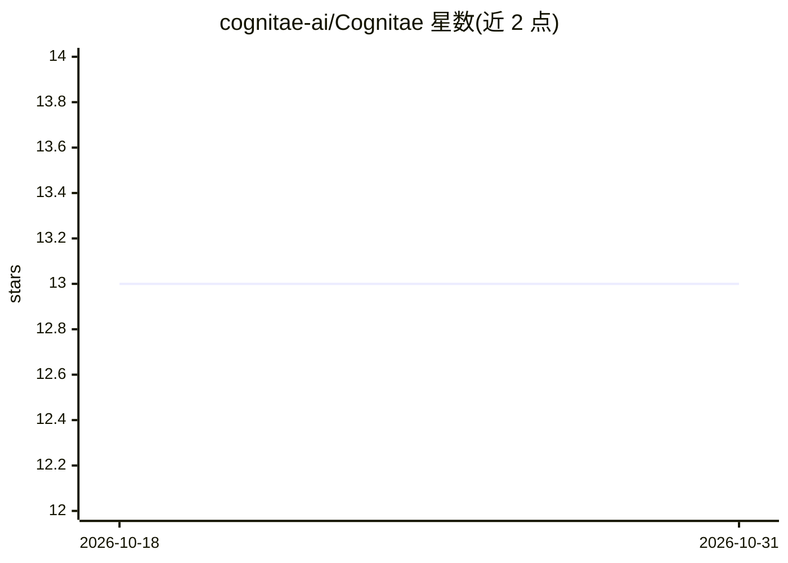

# cognitae-ai/Cognitae

⭐ 13 · JavaScript · AGPL-3.0 · 推送 2026-03-22 · [GitHub](https://github.com/cognitae-ai/Cognitae) · 个人维护

**22 个 YAML 定义的 AI agent 框架，可直接对话使用**

由 22 个模块化 agent 组成的框架，每个 agent 由 13 个人类可读的 YAML/文本模块定义，覆盖战略规划、知识综合、创作、审计、游戏设计与多 agent 编排六类。设计目标是架构化约束 LLM 的谄媚、寄生社交等失效模式。全部 agent 已部署为可直接对话的 Google Gem；也可在任何支持文件附件与自定义系统指令的 LLM 环境（Gemini/Claude/GPT/DeepSeek）中手动加载模块文件激活，Caspian 编排器可摄取其他 agent 架构组成 16 种 Ring 工作流。附带 10 轮示例对话与 66 本阅读清单，托管启动器应用标注为 Work in Progress。

## 筛选速览

| 维度 | 判定 | 备注 |
|---|---|---|
| AI 角色 | `ai-native` | 本体是模型或模型工具 |
| 许可风险 | `viral` | AGPL-3.0 |
| 部署形态 | `None` |  |
| 模型依赖 | — | README 未给出锁定关系 |
| 硬件要求 | — | 无带数字的原话,不猜 |
| 安装摩擦 | `low` | 无编译、无系统依赖或容器化 |
| 成熟度 | — | 结构信号不足 |

## 能力要点

- 22 个 agent，每个由 13 个 YAML/文本模块定义
- 每个 agent 提供可即时对话的线上 Google Gem
- Caspian 编排器与 16 个预配置多 agent Ring
- 兼容任何支持文件附件与自定义系统指令的 LLM 环境

## 适用场景

- 直接在线试用某个专业 agent（如苏格拉底式伦理导航、项目进度追踪）
- 把 agent 模块文件加载到自己的 Gemini/Claude/GPT 环境中运行
- 用 Caspian Ring 组合多 agent 完成创作或审计工作流

## 场景标签

`Agent 框架` `多智能体` · 领域:Agent 开发

## 证据(README 行号)

> L3: Standard LLMs are structurally incentivised toward sycophancy, parasocial bonding, and flattery. Cognitae is a modul
> L9: One agent from each class, demonstrating the range of the framework. Every one is a live Google Gem you can talk to 
> L129: The Cognitae Framework is designed to work in any LLM environment that supports file attachments and custom system

## 星数曲线

2026-10-18 13 → 2026-10-31 13（+0）

---
*卡片 v1 · prompt 1.4 · 生成 2026-10-31 · 置信度 high · 依据 README sha `65b76bd533df` · [字段定义](../../DATASET.md)*
