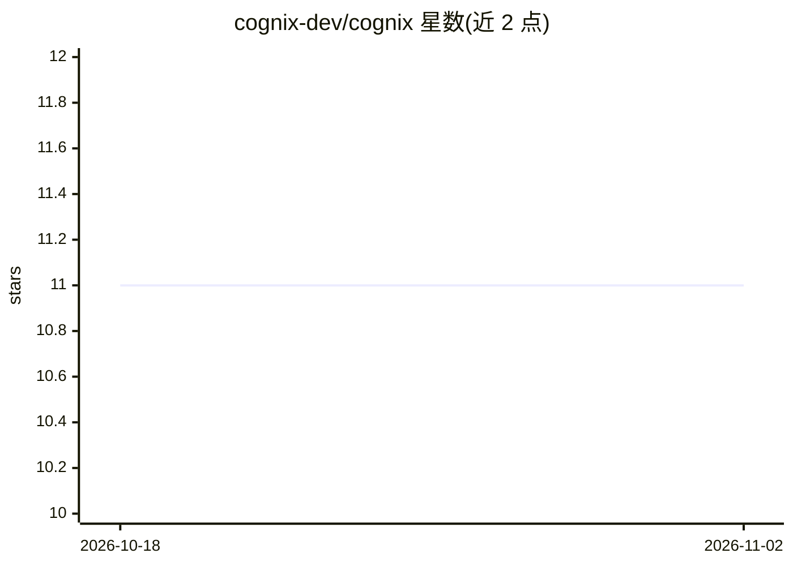

# cognix-dev/cognix

⭐ 11 · Python · Apache-2.0 · 推送 2026-03-09 · [GitHub](https://github.com/cognix-dev/cognix) · [官网](https://cognix-dev.github.io/cognix/) · 组织维护

**基于 flow engineering 的自主代码生成 CLI 工具**

面向开发者的命令行工具：用户通过 /make 命令描述需求或引用规格文件（Markdown spec），由 LLM 自主生成代码。首次运行提供交互式向导配置 API key，写入 ~/.cognix/.env。支持 Anthropic Claude（默认）、OpenAI、OpenRouter 三类 provider，可用 /model 切换模型；亦可作为 MCP Server 被 Claude Desktop、Cursor、VSCode 调用。数据存储于本地 ~/.cognix/，声明无遥测。需 Python 3.9+ 与网络连接。

## 筛选速览

| 维度 | 判定 | 备注 |
|---|---|---|
| AI 角色 | `ai-native` | 本体是模型或模型工具 |
| 许可风险 | `permissive` | Apache-2.0 |
| 部署形态 | `None` |  |
| 模型依赖 | locked-api |  |
| 硬件要求 | — | 无带数字的原话,不猜 |
| 安装摩擦 | `low` | 无编译、无系统依赖或容器化 |
| 成熟度 | — | 结构信号不足 |

## 能力要点

- /make 命令从自然语言描述或规格文件生成代码
- 交互式向导配置 API key，支持 Anthropic/OpenAI/OpenRouter
- 可作为 MCP Server 被 Claude Desktop、Cursor、VSCode 等调用
- 声明无遥测，数据存于本地 ~/.cognix/

## 适用场景

- 用自然语言描述需求直接生成代码
- 基于 Markdown 规格文件（如示例 Tetris spec）生成项目
- 在 Claude Desktop 或 Cursor 中通过 MCP 调用 Cognix

## 场景标签

`代码生成` `编码 Agent` · 领域:编码与开发

## 证据(README 行号)

> L31: cognix> /make @sample_spec_tetris.md
> L37: cognix> /make "landing page with HTML and CSS"

## 星数曲线

2026-10-18 11 → 2026-11-02 11（+0）

---
*卡片 v1 · prompt 1.4 · 生成 2026-11-02 · 置信度 high · 依据 README sha `b2d23a167191` · [字段定义](../../DATASET.md)*
