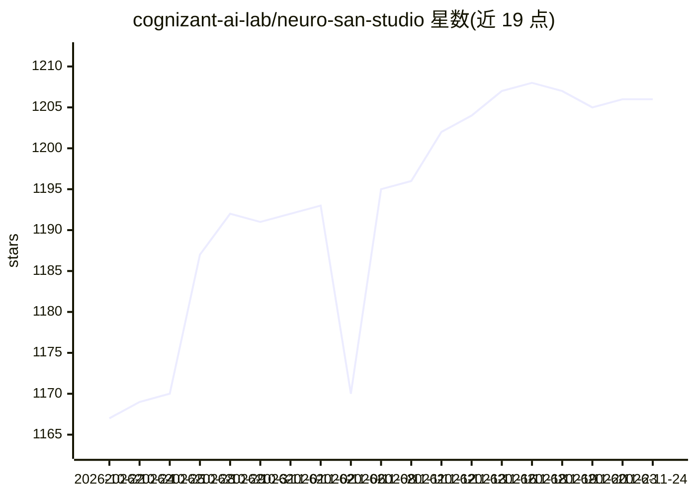

# cognizant-ai-lab/neuro-san-studio

⭐ 1,206 · Python · Apache-2.0 · 推送 2026-11-21 · [GitHub](https://github.com/cognizant-ai-lab/neuro-san-studio) · [官网](https://decisionai.ml/neuro-san) · 组织维护

**为开发者与领域专家提供构建多智能体系统的示例与工具集**

Neuro SAN 框架的实操示例库，提供可运行的多智能体网络示例、教程与工具。核心机制：用 HOCON 声明式配置文件定义整个 agent 网络，通过 AAOSA 协议让 LLM 驱动的 agent 自主委派子任务，Sly Data 机制在 agent 间传递敏感数据而不暴露给语言模型。附带 Agent Network Designer 元智能体，可从自然语言描述生成新的 agent 网络。提供 ns CLI（init/import/export/run）与 nsflow 开发者 UI，服务监听 localhost:8080。使用需自行配置 LLM API key；完整能力需克隆仓库按开发指南设置。

## 筛选速览

| 维度 | 判定 | 备注 |
|---|---|---|
| AI 角色 | `ai-ecosystem` | LLM/agent 周边工具 |
| 许可风险 | `permissive` | Apache-2.0 |
| 部署形态 | `library` | 以包/库形式分发 |
| 模型依赖 | local-ok | 支持本地模型 |
| 硬件要求 | — | 无带数字的原话,不猜 |
| 安装摩擦 | `low` | 无编译、无系统依赖或容器化 |
| 成熟度 | — | 结构信号不足 |

## 能力要点

- HOCON 声明式配置定义整个 agent 网络，无需大量编码
- AAOSA 协议实现 agent 间去中心化的任务委派
- Agent Network Designer 可从自然语言描述生成 agent 网络
- Sly Data 机制在 agent 间传递敏感数据而不暴露给语言模型

## 适用场景

- 用声明式配置快速搭建多智能体协作应用原型
- 让非技术领域专家通过配置文件参与设计 agent 网络
- 把自定义 Python 工具、API、MCP/A2A 等外部 agent 接入工作流
- 通过日志、追踪与会话级指标调试多智能体系统

## 场景标签

`Agent 框架` `多智能体` · 领域:Agent 开发

## 证据(README 行号)

> L51: **Neuro AI system of agent networks (Neuro SAN)** is an open-source,
> L52: data-driven multi-agent orchestration framework designed to simplify and accelerate the development of collaborativ
> L79: * **🌐 Extensible and Cloud-Agnostic**: Compatible with a wide variety of LLM providers (OpenAI, Anthropic, Azure, O

## 星数曲线

2026-10-22 1,167 → 2026-11-24 1,206（+39）

---
*卡片 v1 · prompt 1.4 · 生成 2026-11-24 · 置信度 high · 依据 README sha `134363bca7d6` · [字段定义](../../DATASET.md)*
