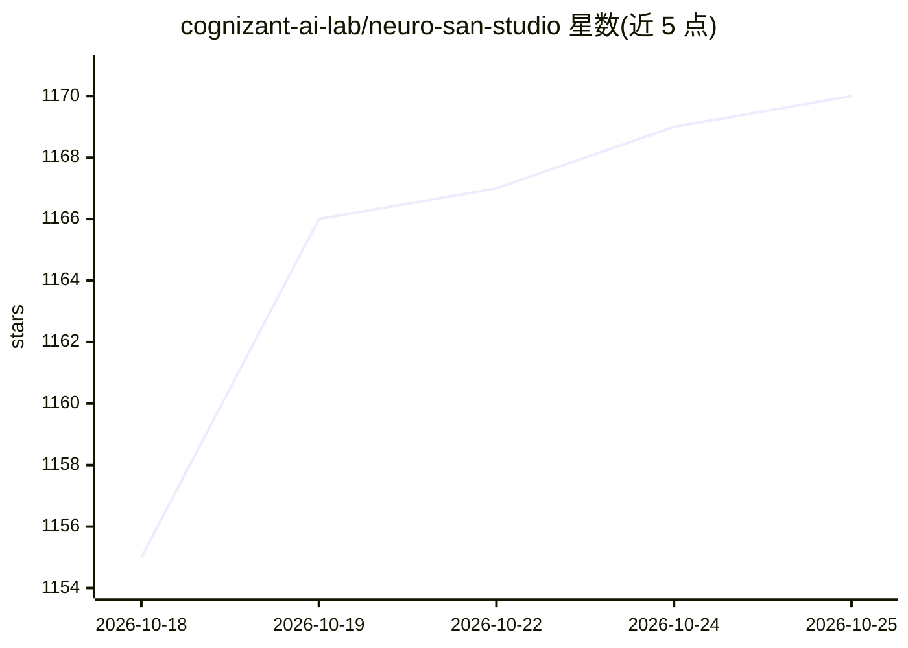

# cognizant-ai-lab/neuro-san-studio

⭐ 1,170 · Python · Apache-2.0 · 推送 2026-10-23 · [GitHub](https://github.com/cognizant-ai-lab/neuro-san-studio) · [官网](https://decisionai.ml/neuro-san) · 组织维护

**Neuro SAN 多智能体编排框架的上手实验场与工具集**

Cognizant AI Lab 维护的 Neuro SAN 框架 playground：提供可运行示例、教程与 CLI 工具（ns init/import/run），初始化 HOCON 配置目录、导入示例智能体网络（含 Agent Network Designer 元智能体，可从自然语言生成新网络）、启动 neuro-san 服务器与 nsflow 开发者 UI。Neuro SAN 本身是数据驱动的多智能体编排框架，通过 HOCON 声明式配置定义网络，采用 AAOSA 自适应通信协议，兼容多种 LLM 提供商，支持集成 MCP、CrewAI、LangChain 工具等外部生态。安装说明面向 Linux/macOS。

## 筛选速览

| 维度 | 判定 | 备注 |
|---|---|---|
| AI 角色 | `ai-ecosystem` | LLM/agent 周边工具 |
| 许可风险 | `permissive` | Apache-2.0 |
| 部署形态 | `library` | 以包/库形式分发 |
| 模型依赖 | local-ok | 支持本地模型 |
| 硬件要求 | — | 无带数字的原话,不猜 |
| 安装摩擦 | `low` | 无编译、无系统依赖或容器化 |
| 成熟度 | — | 结构信号不足 |

## 能力要点

- HOCON 声明式配置定义智能体网络
- Agent Network Designer 元智能体从自然语言生成网络
- ns CLI：init/import/export/run 与 LLM 密钥/配置检查
- nsflow 开发者 UI 与 localhost:8080 服务器

## 适用场景

- 快速搭建并测试多智能体网络原型
- 用自然语言描述需求让 Agent Network Designer 生成网络
- 导入示例网络（航空客服、银行合规等）进行学习与改造

## 场景标签

`多智能体` `Agent 框架` `教程课程` · 领域:Agent 开发

## 证据(README 行号)

> L32: **Your launchpad for building intelligent multi-agent systems.** Neuro SAN Studio is a hands-on playground for the
> L51: **Neuro AI system of agent networks (Neuro SAN)** is an open-source,
> L52: data-driven multi-agent orchestration framework designed to simplify and accelerate the development of collaborativ

## 星数曲线

2026-10-18 1,155 → 2026-10-25 1,170（+15）

---
*卡片 v1 · prompt 1.4 · 生成 2026-10-21 · 置信度 high · 依据 README sha `59aaf2378f7a` · [字段定义](../../DATASET.md)*
