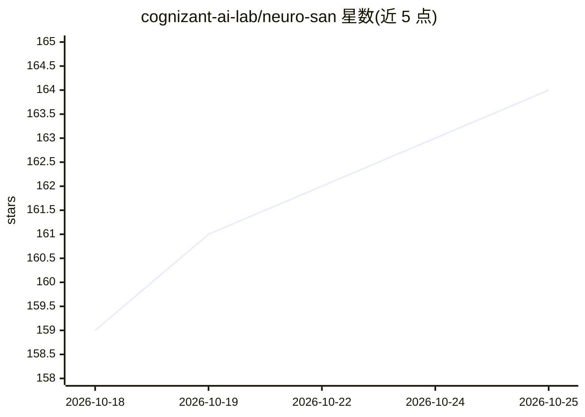

# cognizant-ai-lab/neuro-san

⭐ 164 · Python · Apache-2.0 · 推送 2026-10-24 · [GitHub](https://github.com/cognizant-ai-lab/neuro-san) · [官网](https://decisionai.ml/neuro-san) · 组织维护

**数据驱动多智能体网络构建库，可用作库或 HTTP 服务**

Neuro SAN 是用于构建多 LLM 智能体网络的 Python 库，可将复杂问题拆分给多个互相通信的智能体协作解决。网络用 HOCON 数据文件描述，非程序员也可编写；同时支持调用 CodedTools 执行 LLM 无法完成的确定性任务。提供 LLM 供应商无关配置、私有数据通道（sly_data）、fallback LLM、可观测性数据输出、数据驱动测试与 LLM 测试、MCP 服务端、BYOK 客户端密钥支持。可作为库直接使用，或经 HTTP 服务器对外提供，附 docker 部署脚本。

## 筛选速览

| 维度 | 判定 | 备注 |
|---|---|---|
| AI 角色 | `ai-ecosystem` | LLM/agent 周边工具 |
| 许可风险 | `permissive` | Apache-2.0 |
| 部署形态 | `self-host` | docker 或自建部署 |
| 模型依赖 | — | README 未给出锁定关系 |
| 硬件要求 | — | 无带数字的原话,不猜 |
| 安装摩擦 | `low` | 无编译、无系统依赖或容器化 |
| 成熟度 | — | 结构信号不足 |

## 能力要点

- HOCON 数据文件描述智能体网络，无需编程即可搭建
- CodedTools 执行 LLM 无法完成的确定性任务（调 API、复杂数学等）
- 私有数据通道 sly_data 使敏感数据不进入聊天流
- 可观测性/tracing 输出兼容 LangSmith、Langfuse、Arize Phoenix、HoneyHive

## 适用场景

- 把大任务拆分给多个 LLM 智能体协作完成
- 让领域专家用数据文件（非代码）编写智能体网络
- 以 MCP 服务器或 HTTP 服务形式对外提供智能体网络

## 场景标签

`Agent 框架` `多智能体` · 领域:Agent 开发

## 证据(README 行号)

> L5: **Neuro AI system of agent networks (Neuro SAN)** is a library for building data-driven multi-agent networks
> L16: Neuro SAN agent networks can be entirely specified in a data-only
> L226: The agent infrastructure is run as a library, or as an HTTP service.

## 星数曲线

2026-10-18 159 → 2026-10-25 164（+5）

---
*卡片 v1 · prompt 1.4 · 生成 2026-10-22 · 置信度 high · 依据 README sha `32df2ea045df` · [字段定义](../../DATASET.md)*
