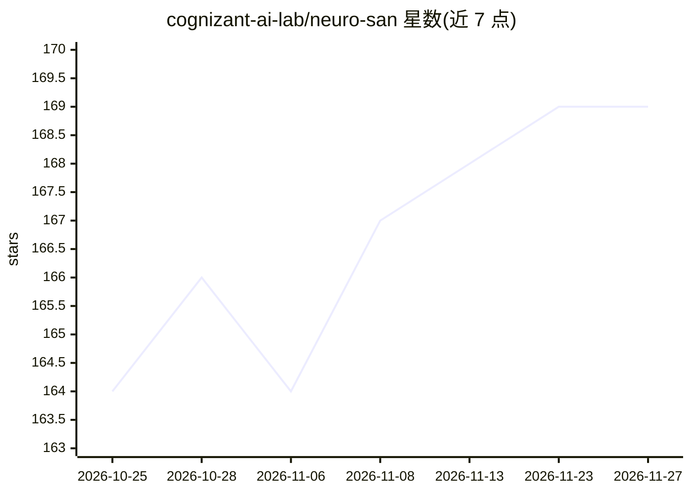

# cognizant-ai-lab/neuro-san

⭐ 169 · Python · Apache-2.0 · 推送 2026-11-23 · [GitHub](https://github.com/cognizant-ai-lab/neuro-san) · [官网](https://decisionai.ml/neuro-san) · 组织维护

**数据驱动的多智能体网络构建库，供开发者编排协作 agent**

Neuro SAN 是构建数据驱动多智能体网络的 Python 库，可作为库直接调用或以 HTTP 服务形式运行。网络完全由 HOCON 数据文件定义，使领域专家无需编程即可编写复杂 agent 网络；也可通过 CodedTools（langchain 或自定义接口）执行 LLM 无法独立完成的任务。提供 sly_data 私有数据通道、每个 agent 独立的 LLM 规格与回退配置、调试信息、MCP Server 协议接口、可观测性数据流及 agent 网络测试基础设施。

## 筛选速览

| 维度 | 判定 | 备注 |
|---|---|---|
| AI 角色 | `ai-ecosystem` | LLM/agent 周边工具 |
| 许可风险 | `permissive` | Apache-2.0 |
| 部署形态 | `self-host` | docker 或自建部署 |
| 模型依赖 | — | README 未给出锁定关系 |
| 硬件要求 | — | 无带数字的原话,不猜 |
| 安装摩擦 | `low` | 无编译、无系统依赖或容器化 |
| 成熟度 | — | 结构信号不足 |

## 能力要点

- HOCON 数据文件即可定义完整 agent 网络，无需编程
- sly_data 私有数据通道，避免敏感数据进入 LLM 聊天流
- 每个 agent 可独立配置 LLM 规格，并支持回退 LLM
- 每个 Neuro SAN 服务端可作为 MCP Server

## 适用场景

- 将复杂任务拆分为多个协作 agent 共同完成
- 让领域专家以纯数据配置方式编写 agent 网络
- 为 agent 网络搭建测试与失败分类评估基础设施
- 以 HTTP 服务形式托管 agent 供客户端调用

## 场景标签

`Agent 框架` `多智能体` · 领域:Agent 开发

## 证据(README 行号)

> L5: **Neuro AI system of agent networks (Neuro SAN)** is a library for building data-driven multi-agent networks
> L13: Solution: Allow these problems to be broken up into smaller pieces so that multiple LLM-enabled
> L226: The agent infrastructure is run as a library, or as an HTTP service.

## 星数曲线

2026-10-25 164 → 2026-11-27 169（+5）

---
*卡片 v1 · prompt 1.4 · 生成 2026-11-26 · 置信度 high · 依据 README sha `7ac714d89a05` · [字段定义](../../DATASET.md)*
