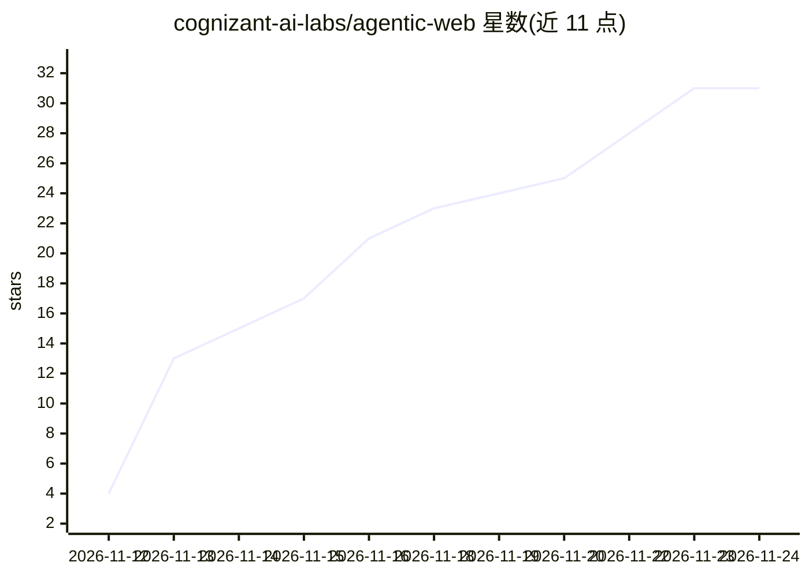

# cognizant-ai-labs/agentic-web

⭐ 31 · JavaScript · Apache-2.0 · 推送 2026-11-22 · [GitHub](https://github.com/cognizant-ai-labs/agentic-web) · [官网](https://worldwideagenticweb.org/) · 组织维护

**开放 Agentic Web 挑战：让网站在浏览器中运行可互联的 agent 网络**

Cognizant AI Labs 维护的开放 agentic web 规范与示例仓库：定义公开可访问的 agent 网站最小规范——用 JSON 描述 agent 网络、在浏览器内执行、用户自带 LLM 提供商与密钥，host 不承担 LLM 调用费用。提供披萨餐厅等网站 agentify 的分步示例、agentify-website 技能（SKILL.md 供编码 agent 跟随，需 Node.js 22+）、跨站 URL 互联机制与 DevPost 黑客松。附 Neuro SAN、Mozilla Otari 两个可选起步工具。仓库自述内容频繁变动。

## 筛选速览

| 维度 | 判定 | 备注 |
|---|---|---|
| AI 角色 | `ai-ecosystem` | LLM/agent 周边工具 |
| 许可风险 | `permissive` | Apache-2.0 |
| 部署形态 | `None` |  |
| 模型依赖 | — | README 未给出锁定关系 |
| 硬件要求 | — | 无带数字的原话,不猜 |
| 安装摩擦 | `low` | 无编译、无系统依赖或容器化 |
| 成熟度 | `idea` | |

## 能力要点

- agent 网络以 JSON 配置描述并在浏览器内执行，无需服务端代码
- 用户自选 LLM 提供商与密钥，站点托管方不支付 LLM 调用
- agent 网络可经 URL 相互调用，并支持 MCP / WebMCP 工具
- agentify-website 技能可让编码 agent 对任意网站执行 agentify 流程

## 适用场景

- 把现有网站改造成可问答、可下单的 agentic 网站
- 参加黑客松构建互联互通的公开 agent 网站
- 让不同站点的 agent 网络互相调用扩展能力

## 场景标签

`Agent 框架` · 领域:Agent 开发

## 证据(README 行号)

> L30: An open agentic website is a public website that contains:
> L41: - Agent networks are **executed in the browser**, without any specific server-side code.

## 星数曲线

2026-11-12 4 → 2026-11-24 31（+27）

---
*卡片 v1 · prompt 1.4 · 生成 2026-11-18 · 置信度 high · 依据 README sha `9f3cb9f37f96` · [字段定义](../../DATASET.md)*
