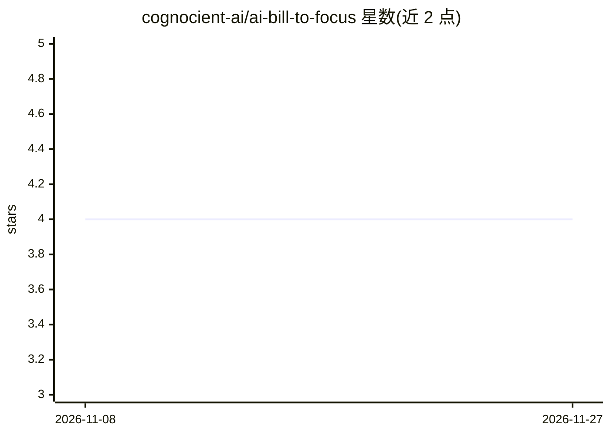

# cognocient-ai/ai-bill-to-focus

⭐ 4 · TypeScript · MIT · 推送 2026-11-07 · [GitHub](https://github.com/cognocient-ai/ai-bill-to-focus) · [官网](https://www.cognocient.com/tools/focus-checker) · 组织维护

**把 Anthropic/OpenAI/Together AI 账单转成 FinOps FOCUS CSV 的本地 CLI**

读取 AI 供应商的账单导出（Anthropic、OpenAI、Together AI），按天/模型/token 类型转换为 FOCUS 1.4 格式 CSV，并可用内置的规则检查器对任意 CSV 按 FOCUS 1.2–1.4 校验。转换基于表头列名识别文件角色，支持供应商定价对账、Batch/Flex/Priority 分层计费拆分，未读列与非数字单元格会记录并使退出码为 1，便于接入 CI。全部在本地运行，除下载公开价格表外无网络请求，可用 --offline 或自定义价格文件。提供浏览器版工具与 report 命令生成可公开分享的脱敏摘要。

## 筛选速览

| 维度 | 判定 | 备注 |
|---|---|---|
| AI 角色 | `ai-ecosystem` | LLM/agent 周边工具 |
| 许可风险 | `permissive` | MIT |
| 部署形态 | `library` | 以包/库形式分发 |
| 模型依赖 | locked-api |  |
| 硬件要求 | — | 无带数字的原话,不猜 |
| 安装摩擦 | `low` | 无编译、无系统依赖或容器化 |
| 成熟度 | — | 结构信号不足 |

## 能力要点

- 将 Anthropic/OpenAI/Together AI 账单导出转换为 FOCUS 1.4 CSV，逐行拆分缓存写入/读取、输入输出 token
- 内置 focus-validator 规则模型的 JavaScript 移植，可按 1.2/1.3/1.4 校验任意 CSV，退出码可作为 CI 门禁
- report 命令生成不含金额与账号信息的可粘贴问题报告
- 本地运行，文件不上传；--offline/--prices 支持离线或自定义价格表

## 适用场景

- 把每月 Claude Console/OpenAI 账单导出整理成 FOCUS 标准格式入分析流程
- 在 CI 中校验成本 CSV 是否符合 FOCUS 1.2–1.4 规则
- 本地处理账单，文件不上传

## 场景标签

 · 领域:FinOps/AI 成本管理

## 证据(README 行号)

> L3: Turn AI provider bills into FinOps FOCUS 1.4 CSV, and check any CSV against the FOCUS 1.2, 1.3 or 1.4 rules. Everyth
> L40: Bedrock, Vertex AI, Azure OpenAI and the Gemini API bill through their cloud, and those clouds already export FOCUS
> L92: Applicability criteria decide which conditional columns are required. The default, `ai`, declares what a direct AI 

## 星数曲线

2026-11-08 4 → 2026-11-27 4（+0）

---
*卡片 v1 · prompt 1.4 · 生成 2026-11-21 · 置信度 high · 依据 README sha `db8ac6046e70` · [字段定义](../../DATASET.md)*
