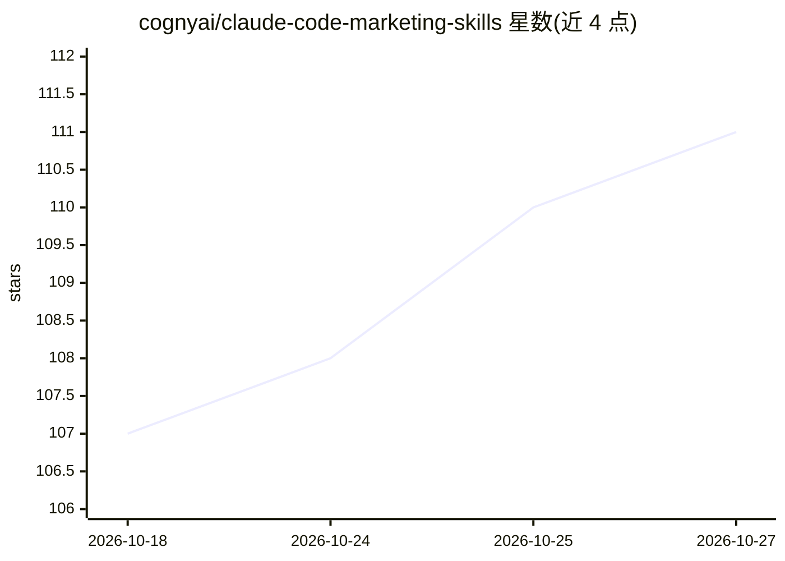

# cognyai/claude-code-marketing-skills

⭐ 111 · HTML · 推送 2026-10-12 · [GitHub](https://github.com/cognyai/claude-code-marketing-skills) · [官网](https://cogny.com) · 组织维护

**面向 Claude Code 等 AI 编码工具的营销技能包（SEO/广告/邮件）**

Cogny 公司维护的营销类 agent 技能集合，安装到 Claude Code、Cursor、Windsurf、Codex 等工具的技能目录后以斜杠命令调用。免费技能（约 23 个）基于网络搜索与公开数据，覆盖 SEO 审计、竞品分析、广告文案、GA4/GTM 配置参考、邮件送达性检查等；付费技能（$9/月）通过 Cogny 托管的 MCP 服务器接入 Google Ads、LinkedIn Ads、Search Console、HubSpot、各 ESP 的真实账户数据。另有 beta 阶段的 Marketing Engineer 技能组，含护栏机制（广告以暂停状态创建、外联仅起草不发送）。提供 curl 安装脚本与 git clone 手动安装两种方式。

## 筛选速览

| 维度 | 判定 | 备注 |
|---|---|---|
| AI 角色 | `ai-ecosystem` | LLM/agent 周边工具 |
| 许可风险 | `none` | — |
| 部署形态 | `None` |  |
| 模型依赖 | — | README 未给出锁定关系 |
| 硬件要求 | — | 无带数字的原话,不猜 |
| 安装摩擦 | `low` | 无编译、无系统依赖或容器化 |
| 成熟度 | `idea` | |

## 能力要点

- 免费技能无需账户，覆盖 SEO 审计/广告分析/转化追踪调试等营销任务
- 付费技能经 Cogny 托管 MCP 接入真实广告、CRM、邮件平台数据（$9/月）
- 支持 Claude Code、Cursor、Windsurf、Codex 等多种 AI 编码工具的技能目录
- Marketing Engineer beta 技能组内置工具级护栏（广告暂停创建、外联草稿不发送）

## 适用场景

- 在终端里让 Claude Code 执行网站 SEO 审计或竞品分析
- 把 AI 编码工具接入真实广告账户做 Google/LinkedIn 广告审计与监控
- 基于自己的 ESP 数据批量生成邮件主题行与挽回邮件系列

## 场景标签

`AI 写作` `提示工程` · 领域:Agent 开发

## 证据(README 行号)

> L3: AI marketing skills for Claude Code, Cursor, Windsurf, and other AI coding tools.
> L64: These skills connect to your actual ad accounts and email platforms via Cogny's MCP servers:

## 星数曲线

2026-10-18 107 → 2026-10-27 111（+4）

---
*卡片 v1 · prompt 1.4 · 生成 2026-10-23 · 置信度 high · 依据 README sha `2e8e7016f369` · [字段定义](../../DATASET.md)*
