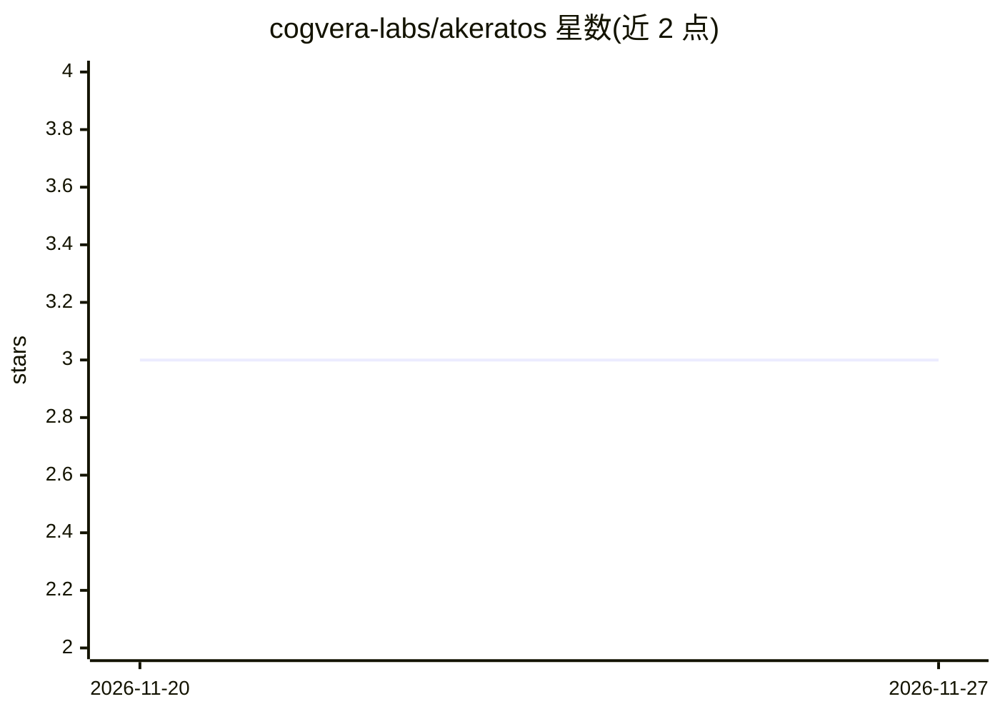

# cogvera-labs/akeratos

⭐ 3 · Python · Apache-2.0 · 推送 2026-11-23 · [GitHub](https://github.com/cogvera-labs/akeratos) · [官网](https://cogveralabs.ai/akeratos) · 组织维护

**在 Apple Silicon Mac 上从零预训练小语言模型的工具**

基于 MLX 的预训练工具，验证一个想法：在小 transformer 旁放置存于统一内存的大规模 n-gram 查找表。提供 bench（对比表开关的训练开销）、starter（41 分钟训练 10M 模型）、speedrun（5 分钟限时训练挑战）、billet（复现 162M 模型）、generate（加载发布权重续写）与 evaluate（评分）等子命令。要求 Apple silicon Mac 与 macOS 14+、uv 0.13.6+；模型在其自身代码中运行，不兼容 mlx-lm 或 llama.cpp。

## 筛选速览

| 维度 | 判定 | 备注 |
|---|---|---|
| AI 角色 | `ai-native` | 本体是模型或模型工具 |
| 许可风险 | `permissive` | Apache-2.0 |
| 部署形态 | `None` |  |
| 模型依赖 | — | README 未给出锁定关系 |
| 硬件要求 | — | 无带数字的原话,不猜 |
| 安装摩擦 | `low` | 无编译、无系统依赖或容器化 |
| 成熟度 | — | 结构信号不足 |

## 能力要点

- 一条命令在单台 Mac 上从零预训练 10M/162M 参数模型
- hashed n-gram 表加在残差流中，实测降低 held-out bits per byte（0.9030→0.8866）
- 五分钟 speedrun 挑战，可通过 pull request 提交成绩
- 发布权重（Billet 及其孪生）可下载用于生成与评分

## 适用场景

- 在消费级 Mac 上实验小语言模型预训练
- 复现 Billet 的训练与评测结果
- 参加五分钟限时训练的 speedrun 挑战

## 场景标签

`模型训练` `模型评测` · 领域:评测与运维

## 证据(README 行号)

> L3: Pretrain a small language model from scratch on your Mac, with MLX. On one M4 Max a first model trains in 41 minutes
> L5: Cogvera Labs built Akeratos to test one idea: a very large learned n-gram table, held in the Mac's unified memory be

## 星数曲线

2026-11-20 3 → 2026-11-27 3（+0）

---
*卡片 v1 · prompt 1.4 · 生成 2026-11-22 · 置信度 high · 依据 README sha `c11746834678` · [字段定义](../../DATASET.md)*
