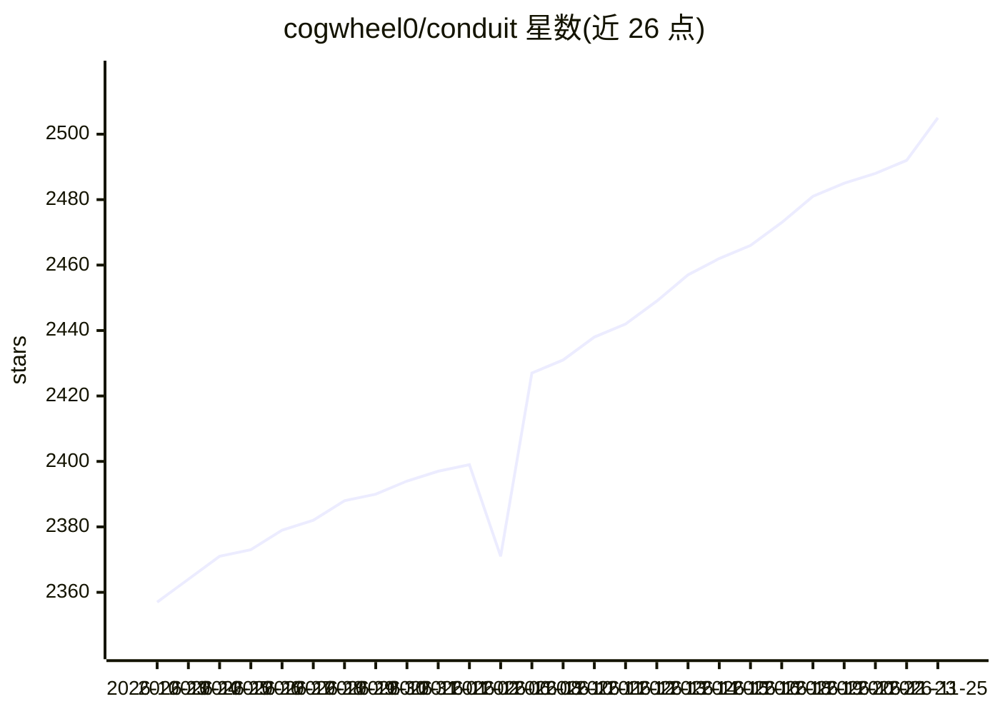

# cogwheel0/conduit

⭐ 2,505 · Dart · GPL-3.0 · 推送 2026-11-24 · [GitHub](https://github.com/cogwheel0/conduit) · [官网](https://conduit.mobile) · 个人维护

**自托管 LLM 服务器的原生 iOS/Android 移动客户端**

基于 Flutter 的原生移动客户端，支持连接 Open WebUI、LibreChat、OpenAI 兼容端点、Ollama、OpenRouter、Apple 本地/私有云模型以及自托管 Hermes agent。针对移动场景处理反向代理认证、后台流式响应、多模态输入等；聊天记录存储在本设备，凭据存放于 Keychain/Keystore，不经维护者后端。通过 App Store 与 Google Play 分发，另有 Apple Silicon Mac 桌面版，可从源码构建。

## 筛选速览

| 维度 | 判定 | 备注 |
|---|---|---|
| AI 角色 | `ai-ecosystem` | LLM/agent 周边工具 |
| 许可风险 | `viral` | GPL-3.0 |
| 部署形态 | `desktop` | 安装包/桌面程序 |
| 模型依赖 | local-ok | 支持本地模型 |
| 硬件要求 | — | 无带数字的原话,不猜 |
| 安装摩擦 | `low` | 无编译、无系统依赖或容器化 |
| 成熟度 | — | 结构信号不足 |

## 能力要点

- 支持 6 种连接方式：Open WebUI、LibreChat、Direct、Apple 本地/云模型、Hermes agent
- WebSocket 逐 token 流式输出与多模态输入（图片/音频粘贴）
- 覆盖 Open WebUI 全部认证路径：LDAP、JWT、SSO/OAuth 及多种反向代理
- 聊天与凭据仅存于设备，无第三方分析或广告 SDK

## 适用场景

- 在手机上访问自托管的 Open WebUI 或 LibreChat 服务器
- 无需服务器，直连本地 Ollama 或 OpenAI 兼容端点聊天
- 在 iOS 26+ 设备上离线使用 Apple 本地模型
- 连接自托管 Hermes agent，审批敏感工具调用并管理定时任务

## 场景标签

`聊天机器人` `AI 助手` · 领域:对话与助手

## 证据(README 行号)

> L10:  A native mobile client for Open WebUI, your own model endpoints, and self-hosted agents.
> L97: |**Direct**|OpenAI-compatible, Ollama, OpenRouter|Talk straight to a provider or a model on your own machine. No Op
> L186: Writing Open WebUI filters or tools? Conduit never runs their JavaScript, but

## 星数曲线

2026-10-23 2,357 → 2026-11-25 2,505（+148）

---
*卡片 v1 · prompt 1.4 · 生成 2026-11-23 · 置信度 high · 依据 README sha `ba09f142e4fb` · [字段定义](../../DATASET.md)*
