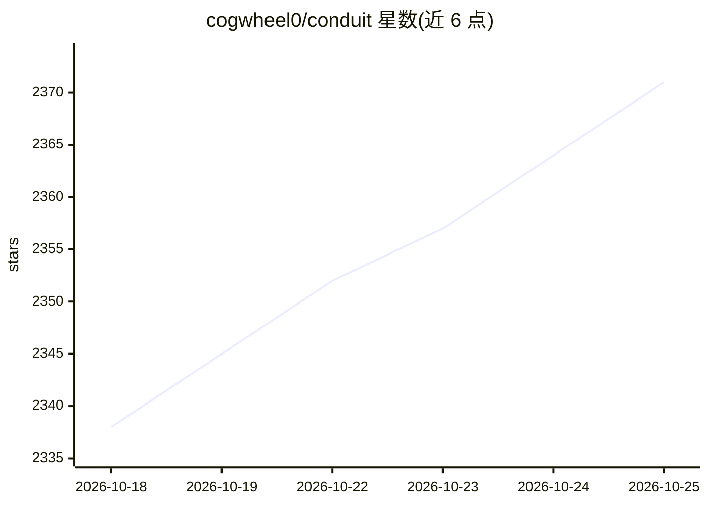

# cogwheel0/conduit

⭐ 2,373 · Dart · GPL-3.0 · 推送 2026-10-25 · [GitHub](https://github.com/cogwheel0/conduit) · [官网](https://conduit.mobile) · 个人维护

**iOS/Android 原生客户端：接入 Open WebUI、自有端点与自托管 agent**

用 Flutter 构建的移动端聊天客户端，面向自托管用户：可连接 Open WebUI 服务器（支持 LDAP/SSO/反向代理等多种认证路径）、OpenAI 兼容端点、原生 Ollama、OpenRouter，以及 iOS 专属的 Apple 本地模型与 Private Cloud Compute；还可接入自托管的 Hermes agent，观看工具执行并批准敏感步骤。聊天数据存于设备本地，凭据使用 Keychain/Keystore，无第三方分析 SDK。另提供企业/白标定制联系渠道。

## 筛选速览

| 维度 | 判定 | 备注 |
|---|---|---|
| AI 角色 | `ai-ecosystem` | LLM/agent 周边工具 |
| 许可风险 | `viral` | GPL-3.0 |
| 部署形态 | `None` |  |
| 模型依赖 | local-ok | 支持本地模型 |
| 硬件要求 | — | 无带数字的原话,不猜 |
| 安装摩擦 | `low` | 无编译、无系统依赖或容器化 |
| 成熟度 | — | 结构信号不足 |

## 能力要点

- 五类连接方式：Open WebUI、Direct（OpenAI 兼容/Ollama/OpenRouter/LM Studio）、Apple On-Device、Apple PCC、Hermes agent
- 支持反向代理（oauth2-proxy/Authelia/Authentik 等）与 LDAP/SSO/JWT 认证路径
- 原生 Flutter 界面：代码高亮、Mermaid 图表、LaTeX、推理/工具调用折叠区
- 语音通话模式、14 种语言、离线笔记与本地数据存储

## 适用场景

- 在手机上使用自托管的 Open WebUI 服务器并保持完整功能
- 直连本机 Ollama 或 OpenAI 兼容端点进行聊天
- 在 iOS 设备上离线使用 Apple 本地模型
- 通过手机管理并批准自托管 Hermes agent 的定时任务

## 场景标签

`AI 助手` `聊天机器人` · 领域:对话与助手

## 证据(README 行号)

> L10:  A native mobile client for Open WebUI, your own model endpoints, and self-hosted agents.
> L95: |**Open WebUI**|Your self-hosted server|Full feature set: chats, folders, notes, channels, workspace, tools, web se
> L96: |**Direct**|OpenAI-compatible, Ollama, OpenRouter|Talk straight to a provider or a model on your own machine. No Op

## 星数曲线

2026-10-18 2,338 → 2026-10-25 2,371（+33）

---
*卡片 v1 · prompt 1.4 · 生成 2026-10-21 · 置信度 high · 依据 README sha `81445fea8b42` · [字段定义](../../DATASET.md)*
