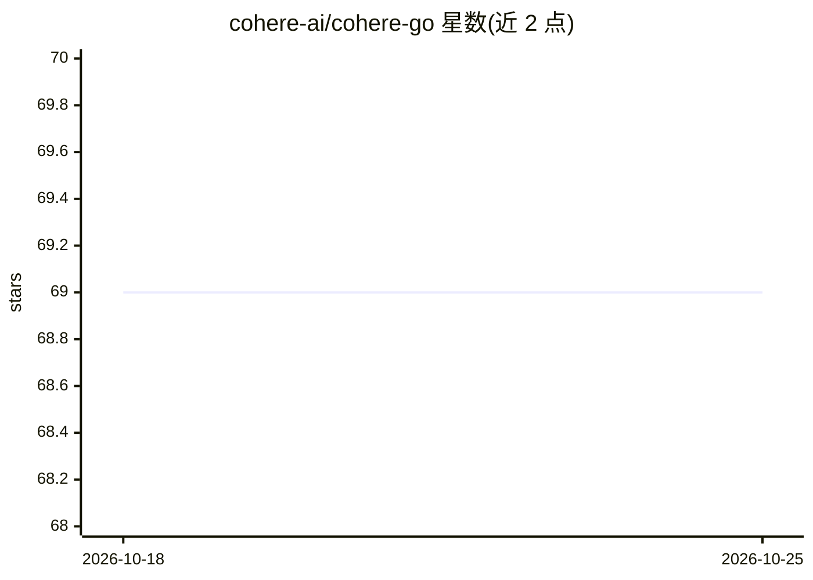

# cohere-ai/cohere-go

⭐ 69 · Go · MIT · 推送 2026-10-21 · [GitHub](https://github.com/cohere-ai/cohere-go) · 组织维护

**官方 Go SDK：在 Go 程序中调用 Cohere API**

由 Cohere 维护的 Go 语言官方 SDK，通过 `go get` 引入后用 API token 初始化客户端，即可在 Go 代码中调用 Cohere 的 Chat、Generate、流式等接口。支持基于 context 的单请求超时、自定义 *http.Client、结构化错误类型（兼容 errors.Is/errors.As）以及流式响应读取。要求 Go 版本不低于 1.18；库自述处于 beta 阶段，版本间可能出现破坏性变更，建议固定包版本。

## 筛选速览

| 维度 | 判定 | 备注 |
|---|---|---|
| AI 角色 | `ai-ecosystem` | LLM/agent 周边工具 |
| 许可风险 | `permissive` | MIT |
| 部署形态 | `None` |  |
| 模型依赖 | locked-api |  |
| 硬件要求 | — | 无带数字的原话,不猜 |
| 安装摩擦 | `low` | 无编译、无系统依赖或容器化 |
| 成熟度 | `idea` | |

## 能力要点

- 提供 Chat/Generate 及流式（ChatStream）接口的 Go 封装
- 结构化错误类型，兼容 errors.Is 与 errors.As
- 支持 context 超时与自定义 *http.Client
- 由 Fern 生成的官方维护 SDK

## 适用场景

- 在 Go 服务端集成 Cohere 的对话与生成接口
- 以流式方式读取 Cohere 响应
- 在 Go 项目中通过结构化错误处理 API 调用失败

## 场景标签

 · 领域:LLM API/开发工具

## 证据(README 行号)

> L6: The Cohere Go library provides convenient access to the Cohere API from Go.
> L10: This module requires Go version >= 1.18.

## 星数曲线

2026-10-18 69 → 2026-10-25 69（+0）

---
*卡片 v1 · prompt 1.4 · 生成 2026-10-24 · 置信度 high · 依据 README sha `5b61a0e5413d` · [字段定义](../../DATASET.md)*
