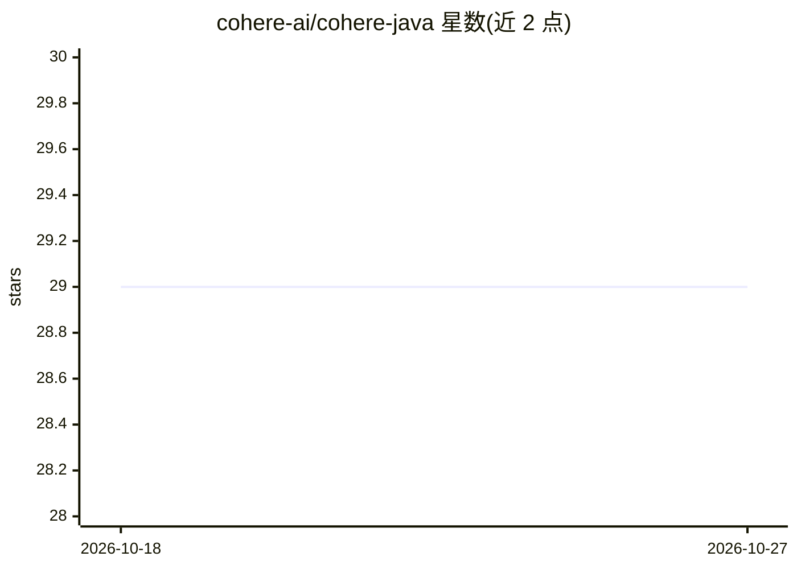

# cohere-ai/cohere-java

⭐ 29 · Java · MIT · 推送 2026-10-21 · [GitHub](https://github.com/cohere-ai/cohere-java) · 组织维护

**Cohere 官方 Java SDK：在 Java 应用中调用 Cohere API**

Cohere 官方发布的 Java SDK，提供 ChatRequest、ChatMessage 等类供 Java 应用调用 Cohere API（含 chat 等端点），通过 Maven Central 分发，支持 Gradle 与 Maven 两种依赖接入方式。错误处理上将 4xx/5xx 响应封装为 ApiError 子类异常。官方声明该 SDK 处于 beta 阶段，版本间可能存在不升级大版本号的破坏性变更，建议在构建文件中固定版本号。面向使用 Java 的开发者。

## 筛选速览

| 维度 | 判定 | 备注 |
|---|---|---|
| AI 角色 | `ai-ecosystem` | LLM/agent 周边工具 |
| 许可风险 | `permissive` | MIT |
| 部署形态 | `None` |  |
| 模型依赖 | locked-api |  |
| 硬件要求 | — | 无带数字的原话,不猜 |
| 安装摩擦 | `low` | 无编译、无系统依赖或容器化 |
| 成熟度 | `idea` | |

## 能力要点

- 官方 Java SDK，覆盖 Cohere API 最新功能
- Gradle 与 Maven 两种依赖接入方式，经 Maven Central 分发
- API 错误封装为 ApiError 子类异常
- 支持异步与流式响应类型（Usage 示例略）

## 适用场景

- 在 Java 项目中集成 Cohere 的 chat 等模型能力
- 通过 Maven/Gradle 依赖管理接入 Cohere API
- 按官方 SDK 处理 Cohere API 的错误响应

## 场景标签

 · 领域:LLM API/开发者工具

## 证据(README 行号)

> L6: ## ✨🪩✨ Announcing Cohere's new Java SDK ✨🪩✨
> L40: import com.cohere.api.Cohere;

## 星数曲线

2026-10-18 29 → 2026-10-27 29（+0）

---
*卡片 v1 · prompt 1.4 · 生成 2026-10-26 · 置信度 high · 依据 README sha `13c96aaa8076` · [字段定义](../../DATASET.md)*
