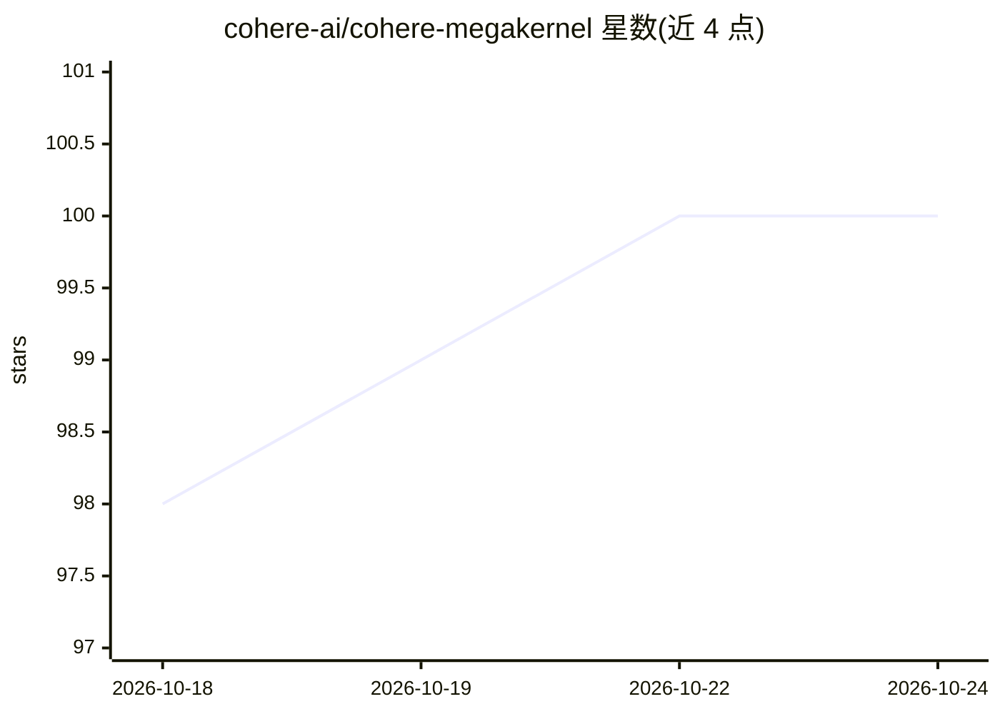

# cohere-ai/cohere-megakernel

⭐ 100 · C++ · Apache-2.0 · 推送 2026-09-08 · [GitHub](https://github.com/cohere-ai/cohere-megakernel) · 组织维护

**面向 H100 的 decode megakernel 推理服务引擎，服务 North Mini Code**

研究性发布：单张 NVIDIA H100 上以单个持久 CUDA megakernel 执行 North Mini Code 完整 decode 前向，通过 OpenAI 兼容 API（completions/chat-completions、流式、tool calling）提供服务。作者声明为早期研究版本而非通用推理引擎，仅测试单 H100（sm_90a）、CUDA 13+、Python 3.12+、batch size 1-8，任务调度绑定 North Mini Code 模型。支持连续批处理、paged KV cache、前缀缓存与抢占；prefill 仍用 PyTorch kernel 且会暂停 decode。基准以 vLLM v0.24 为对照。

## 筛选速览

| 维度 | 判定 | 备注 |
|---|---|---|
| AI 角色 | `ai-ecosystem` | LLM/agent 周边工具 |
| 许可风险 | `permissive` | Apache-2.0 |
| 部署形态 | `None` |  |
| 模型依赖 | — | README 未给出锁定关系 |
| 硬件要求 | — | 无带数字的原话,不猜 |
| 安装摩擦 | `high` | 编译与系统依赖俱全 |
| 成熟度 | `idea` | |

## 能力要点

- 单个持久 CUDA kernel 执行完整 decode 前向，消除逐算子启动开销
- OpenAI 兼容 API，支持流式与 tool calling
- 连续批处理、paged KV cache、sliding-window attention、前缀缓存
- Python 控制平面 + C++ decode 线程的宿主侧分工

## 适用场景

- 在单张 H100 上以研究目的运行 North Mini Code 推理服务
- 复现 decode 吞吐与正确性基准（对照 vLLM v0.24）
- 研究 megakernel 任务图调度与算子移植方法

## 场景标签

`推理引擎` · 领域:训练与推理

## 证据(README 行号)

> L7: A research release of a single-H100 inference engine that serves
> L9: OpenAI-compatible API.

## 星数曲线

2026-10-18 98 → 2026-10-24 100（+2）

---
*卡片 v1 · prompt 1.4 · 生成 2026-10-23 · 置信度 high · 依据 README sha `16a5c75e1646` · [字段定义](../../DATASET.md)*
