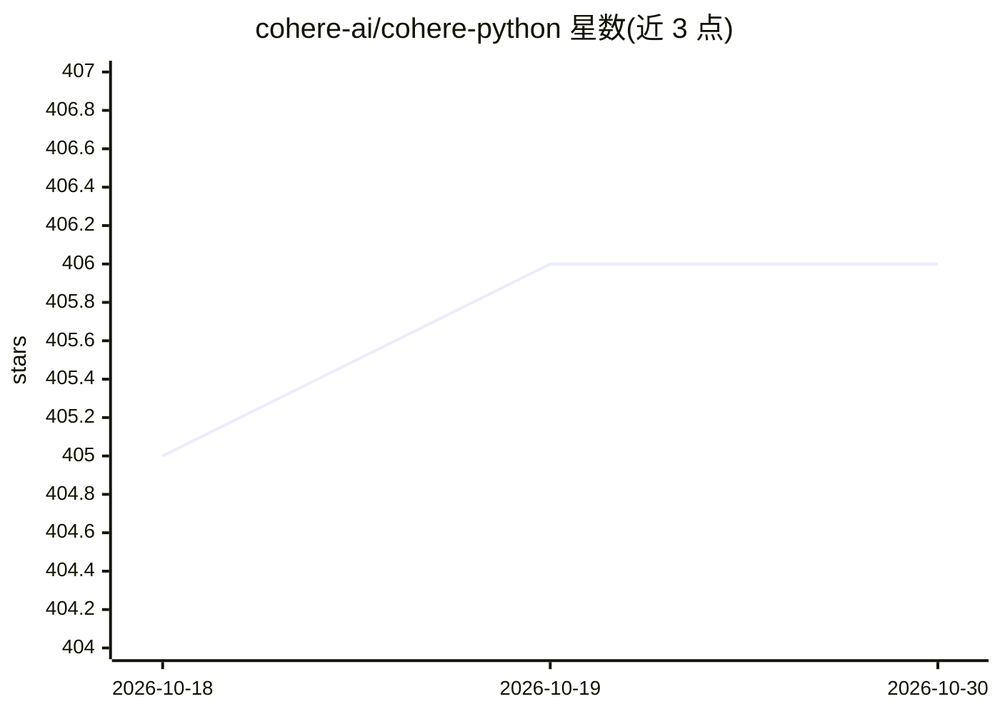

# cohere-ai/cohere-python

⭐ 406 · Python · MIT · 推送 2026-10-27 · [GitHub](https://github.com/cohere-ai/cohere-python) · [官网](https://docs.cohere.ai) · 组织维护

**Cohere 官方 Python SDK：跨平台接入 Cohere 模型 API**

Cohere 官方 Python 库，提供 ClientV2 接入 Cohere 平台的 Chat、Embed、Rerank 等模型 API，支持流式输出（chat_stream）。除 Cohere 自有平台外，可经由 AWS（Bedrock、Sagemaker）、Azure、GCP 与 Oracle OCI 调用 Cohere 模型；针对 OCI Generative AI 提供专属 OciClient 与多种认证方式（config 文件、自定义 profile、安全令牌会话、直接凭证、实例主体），并列明 OCI 上的能力限制（Generate/Rerank 需微调后部署、单请求仅支持单一 embedding 类型）。面向开发者使用。

## 筛选速览

| 维度 | 判定 | 备注 |
|---|---|---|
| AI 角色 | `ai-ecosystem` | LLM/agent 周边工具 |
| 许可风险 | `permissive` | MIT |
| 部署形态 | `library` | 以包/库形式分发 |
| 模型依赖 | locked-api |  |
| 硬件要求 | — | 无带数字的原话,不猜 |
| 安装摩擦 | `low` | 无编译、无系统依赖或容器化 |
| 成熟度 | — | 结构信号不足 |

## 能力要点

- pip 安装，ClientV2 接入 Cohere 模型 API 并支持流式 chat_stream
- 跨平台访问：Cohere 平台、AWS（Bedrock/Sagemaker）、Azure、GCP、Oracle OCI
- OCI 专属客户端支持 5 种认证方式
- 文档列明 OCI 平台上各 API 的可用性与限制

## 适用场景

- 在 Python 应用中调用 Cohere 的 Chat/Embed 等模型 API
- 通过 OCI 专属客户端在 Oracle 云上调用 Cohere 模型
- 以流式方式获取聊天输出

## 场景标签

 · 领域:LLM 基础设施/SDK

## 证据(README 行号)

> L7: The Cohere Python SDK allows access to Cohere models across many different platforms: the cohere platform, AWS (Bedr
> L16: pip install cohere

## 星数曲线

2026-10-18 405 → 2026-10-30 406（+1）

---
*卡片 v1 · prompt 1.4 · 生成 2026-10-21 · 置信度 high · 依据 README sha `464dc0ef06a5` · [字段定义](../../DATASET.md)*
