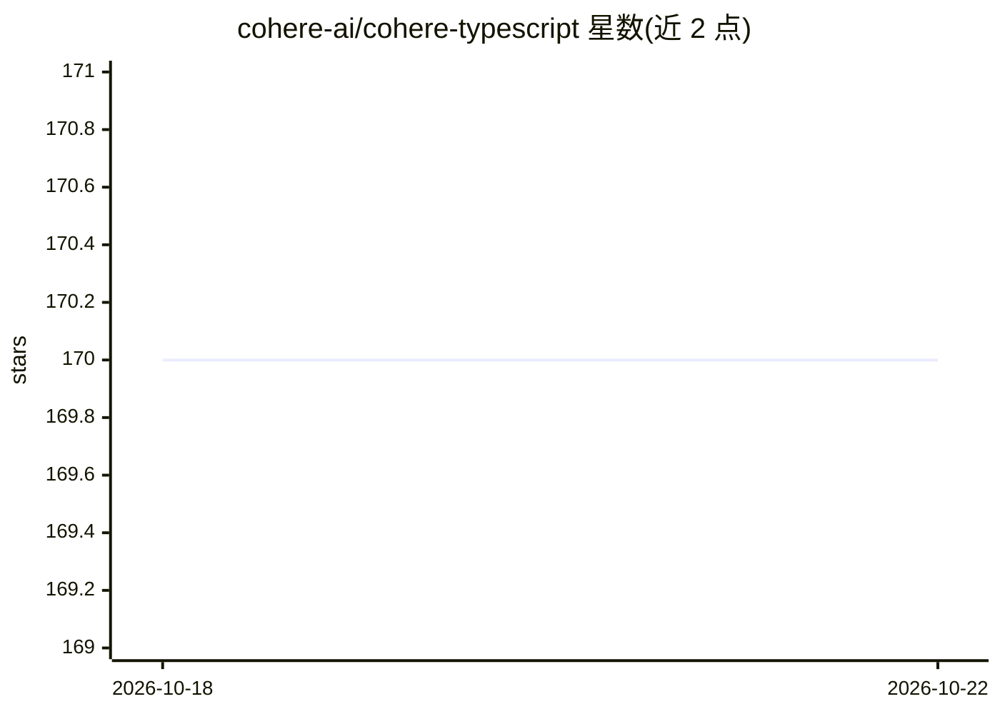

# cohere-ai/cohere-typescript

⭐ 170 · TypeScript · MIT · 推送 2026-10-21 · [GitHub](https://github.com/cohere-ai/cohere-typescript) · [官网](https://docs.cohere.ai) · 组织维护

**Cohere 官方 TypeScript SDK：在 Node.js 中调用 Cohere 模型**

Cohere 官方维护的 TypeScript/JavaScript SDK，提供 CohereClientV2 客户端访问 Cohere 平台及多云（AWS Bedrock、SageMaker、Azure、GCP、Oracle OCI）上的 Cohere 模型。支持流式端点（chatStream）、类型化错误处理（CohereError/CohereTimeoutError）；AWS 客户端经 cohere-ai/aws 子路径导入，依赖为可选 peer dependencies，不会自动安装。npm 安装，SDK 处于 beta 阶段，官方建议锁定包版本以避免非主版本号的破坏性变更。

## 筛选速览

| 维度 | 判定 | 备注 |
|---|---|---|
| AI 角色 | `ai-ecosystem` | LLM/agent 周边工具 |
| 许可风险 | `permissive` | MIT |
| 部署形态 | `library` | 以包/库形式分发 |
| 模型依赖 | locked-api |  |
| 硬件要求 | — | 无带数字的原话,不猜 |
| 安装摩擦 | `low` | 无编译、无系统依赖或容器化 |
| 成熟度 | `idea` | |

## 能力要点

- 跨平台访问 Cohere 模型（Cohere 平台、AWS Bedrock/SageMaker、Azure、GCP、Oracle OCI）
- 流式端点支持（chatStream）
- AWS 子路径客户端（BedrockClient/SagemakerClient 等），AWS 依赖为可选 peer dependencies

## 适用场景

- 在 Node.js/TypeScript 项目中接入 Cohere API
- 通过 AWS Bedrock 或 SageMaker 调用 Cohere 模型
- 构建流式聊天应用

## 场景标签

 · 领域:LLM 基础设施/SDK

## 证据(README 行号)

> L6: The Cohere Typescript SDK allows access to Cohere models across many different platforms: the cohere platform, AWS (
> L21: import { CohereClientV2 } from "cohere-ai";

## 星数曲线

2026-10-18 170 → 2026-10-22 170（+0）

---
*卡片 v1 · prompt 1.4 · 生成 2026-10-22 · 置信度 high · 依据 README sha `290519f49b52` · [字段定义](../../DATASET.md)*
