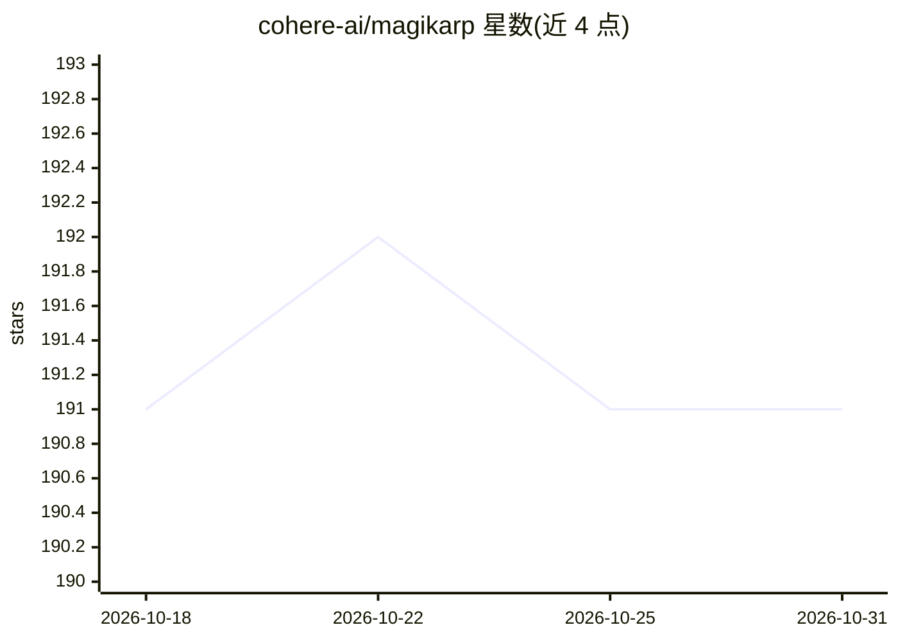

# cohere-ai/magikarp

⭐ 191 · Python · Apache-2.0 · 推送 2026-07-10 · [GitHub](https://github.com/cohere-ai/magikarp) · [官网](https://arxiv.org/abs/2405.05417) · 组织维护

**检测大模型中欠训练 token 的论文代码与结果集**

论文 Fishing for Magikarp 的官方代码库：提供自动检测大语言模型分词器中欠训练（未按预期编码）token 的验证脚本，并对多个模型生成 'full' 与 'mini' 两种格式的详细报告和汇总表，存于 results/ 目录。以 Poetry 项目形式提供，通过 run_verification.sh 参考命令可在其他模型上复现；绑定额外嵌入的模型需在 unused_tokens.py 中手工设定 token id。面向 LLM 分词与训练质量方向的研究者。

## 筛选速览

| 维度 | 判定 | 备注 |
|---|---|---|
| AI 角色 | `ai-knowledge` | 知识聚合/清单类 |
| 许可风险 | `permissive` | Apache-2.0 |
| 部署形态 | `library` | 以包/库形式分发 |
| 模型依赖 | — | README 未给出锁定关系 |
| 硬件要求 | — | 无带数字的原话,不猜 |
| 安装摩擦 | `low` | 无编译、无系统依赖或容器化 |
| 成熟度 | — | 结构信号不足 |

## 能力要点

- 自动检测大模型分词器中欠训练 token
- results/ 目录含逐模型 full/mini 详细报告与汇总表
- 提供 poetry 项目与可复现的验证脚本

## 适用场景

- 查看自己模型分词器中的欠训练 token 报告
- 对其他 Hugging Face 模型复现 token 验证流程
- 研究 LLM 分词质量问题

## 场景标签

`模型评测` · 领域:评测与运维

## 证据(README 行号)

> L1: # Code for the paper "Fishing for Magikarp"
> L3: This repository contains the code and extended results for the paper Fishing for Magikarp: Automatically Detecting U

## 星数曲线

2026-10-18 191 → 2026-10-31 191（+0）

---
*卡片 v1 · prompt 1.4 · 生成 2026-10-22 · 置信度 mid · 依据 README sha `5a84f6a65e34` · [字段定义](../../DATASET.md)*
